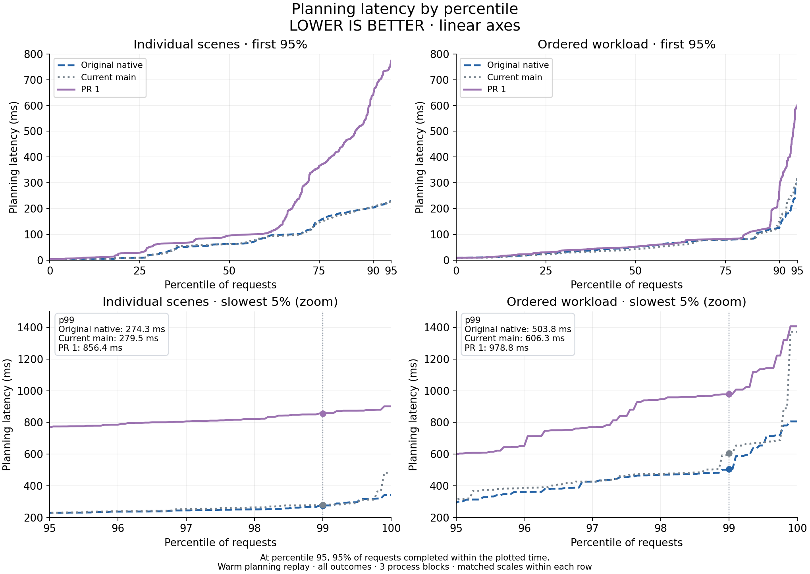
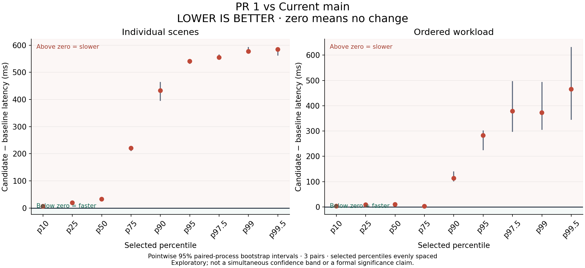
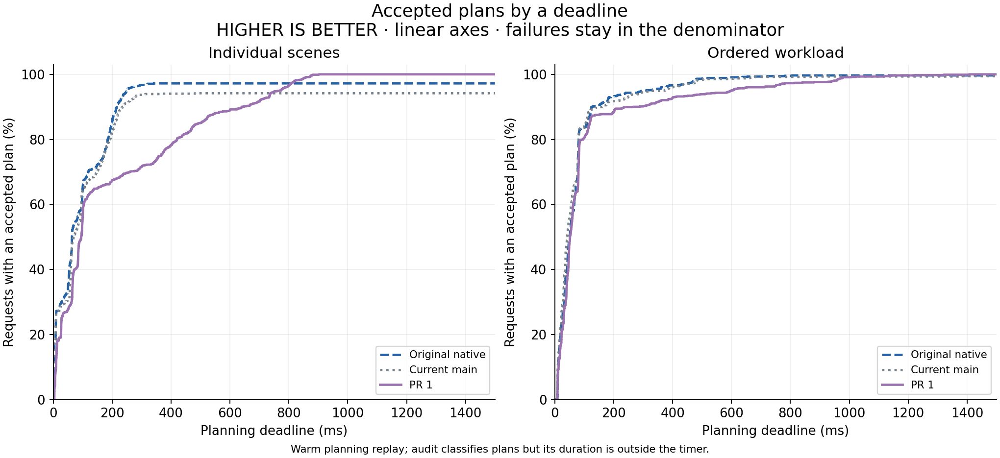

motionplan: preserve collision validation and join canceled native workers

Native validation could reuse an edge under the wrong checking context and skip interpolation samples based on clearance without a bound on link movement. This PR scopes validity reuse correctly, restores required collision sampling and exact geometry identity, and joins canceled native search workers before return. The benefit is valid plans and defined worker lifetime; it does not promise lower latency.

**PR 1 of 4.** Branch `jake/native-1-correctness` at `a2bc4d795553`, targeting `main`. [Stack overview and whole-stack result](README.md). Diff: runtime **+192/−71**, tests/fixtures **+474/−4**, 21 files. No reports, charts or benchmark infrastructure land in this PR.

Cumulative change versus **original native**: scenes +144.2% (+123.75 ms/request; exploratory 95% interval +139.9% to +147.5%); ordered +47.8% (+36.87 ms/request; exploratory 95% interval +45.3% to +50.6%). Accepted plans: original scenes 802/825, ordered 879/882; this head scenes 825/825, ordered 882/882. Fast invalid returns remain in the timing denominator.

Measured complete-planning change versus its preceding head: **individual scenes +144.4% (+123.82 ms/request; exploratory 95% interval +141.7% to +148.6%); ordered workload +47.9% (+36.90 ms/request; exploratory 95% interval +44.8% to +50.9%)**. Negative means less time. This cohort has 3 independent matched process blocks; inference is exploratory.

| Workload / variant | Accepted / attempts | Total s | Median ms | p95 ms | p99 ms |
|---|---:|---:|---:|---:|---:|
| Individual scenes: Original native | 802 / 825 | 70.809 | 62.75 | 229.38 | 274.27 |
| Individual scenes: Current main | 777 / 825 | 70.755 | 62.29 | 227.60 | 279.51 |
| Individual scenes: PR 1 | 825 / 825 | 172.904 | 94.73 | 768.16 | 856.40 |
| Ordered workload: Original native | 879 / 882 | 67.975 | 51.35 | 292.44 | 503.84 |
| Ordered workload: Current main | 877 / 882 | 67.944 | 41.80 | 314.73 | 606.35 |
| Ordered workload: PR 1 | 882 / 882 | 100.491 | 51.38 | 597.07 | 978.76 |

- Scope edge reuse to checker, segment, direction, resolution and endpoint policy.
- Remove unsafe clearance-based skips; enforce a 0.002-radian joint sampling floor while retaining prismatic units and Cartesian resolution.
- Hash exact geometry shape/pose identity; preserve immutable mesh preparation safely and invalidate it on replacement.
- Cancel IK producers before draining results; request NLopt cancellation from its callback.
- Cancel and join all launched CBiRRT/roadmap racers, with enough buffered results for losing senders to finish.
- Preserve regressions for thin/dual-arm collisions and the actual blocked chord returned by the initial extraction.

“Cancellation cleanup” means signaling losing search/IK work to stop and waiting for its required shutdown before returning. A first usable result and all workers exiting are different events. Waiting can expose additional synchronous latency, but avoids leftover work competing with the next plan. Denser required checking can also cost time. PR3 adds conservative acceleration without reinstating the unsafe skip.

Percentile is on the horizontal axis, milliseconds on the vertical axis, both linear. Original native is first; the other curves show the preceding head and this cumulative head. These are complete planning calls, not kernel timings.

Pointwise process-block intervals preserve pairing and cache dependence. They are not simultaneous bands or multiple-comparison-adjusted significance results. Tail observations are sparse; inspect the full distribution and every independent process.

Path-quality comparison with preceding head: sequence/046-153535.297-adding_milk-move.json: path-length p95 17.1% longer; sequence/075-153733.046-serving-carry.json: path-length p95 14.4% longer. Against original: sequence/046-153535.297-adding_milk-move.json: path-length p95 17.1% longer. Joint-space length is not physical execution time.

The six relevant package suites pass on each cumulative head using Go 1.26.10, and configured lint passes against each head’s parent. Focused race checks cover the stack’s concurrent changes, including the corrected validation and cancellation paths. The first two heads’ moved interpolation expectations were checked again after correcting their placement. The observed Go 1.27 JSON round-trip failure also occurs on unchanged main; the complete test passes on the repository toolchain. Full validation and source-equivalence details are in [VALIDATION.md](evidence/VALIDATION.md).

The metric is warm planning replay through the actual motion-service `PlanMotion` call: IK, search, required validation, smoothing, final path construction and synchronous cleanup. Snapshot preparation, RPC, declared warmup, independent audit and hardware execution are excluded. This measures end-to-end planning within that boundary, not request-to-first-motion or physical completion.

Original native is always the primary baseline. All variants use ordinary native routing, default workers and automatic production calibration. Effective calibration varies across heads/processes, so these measurements include the production policy response; they do not isolate constant-budget implementation cost. Runs were serial under recorded desktop activity; no load-based exclusion or retry. Individual-scene headlines weight 11 unique requests equally; duplicate scene08 stays in the ledger with zero headline weight. Ordered results preserve a whole 98-request warmup followed by three dependent passes per process. Paired bootstrap intervals resample whole independent process blocks. All outcomes count; accepted-only distributions, per-process/per-input results, maxima, threshold counts, trajectories and audit accounting are retained. Dense audit is evidence at its resolution, not proof of continuous collision freedom.

Whole-stack context remains **21.7% less ordered planning time / 16.89 ms saved per request** versus original native, with uncertain 2.2% scene improvement and **26.0% worse ordered p99**. All 6,024 full-stack attempts passed the frozen audit. Do not add incremental percentages or pool the separate cohorts. [Complete evidence](evidence/corrected-boundaries/README.md) includes every outcome, accepted-only distributions, per-process/per-input results, path quality, environment, exact commands and hashes.
