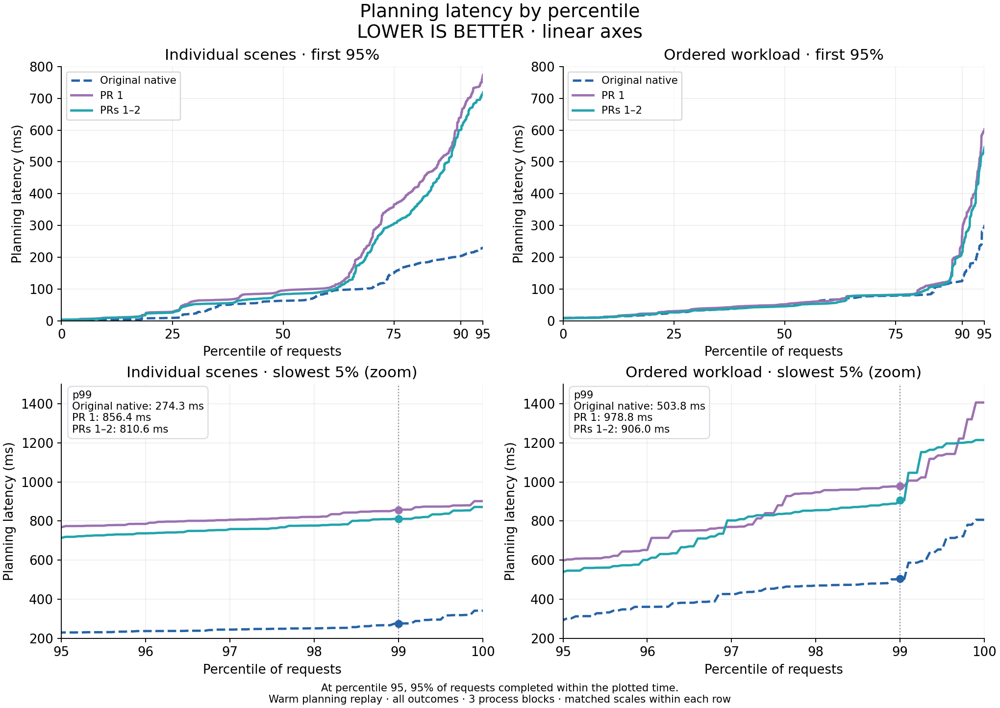
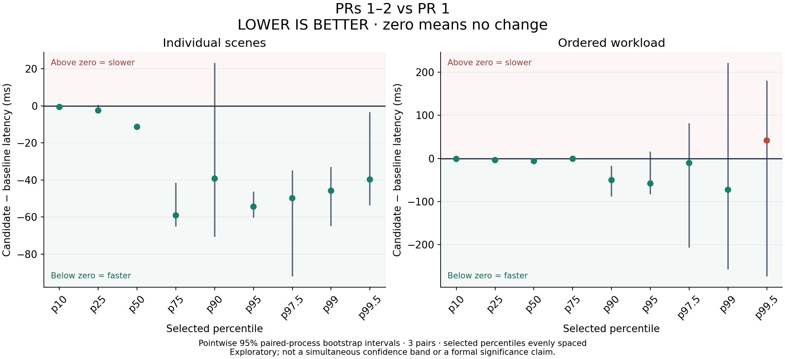
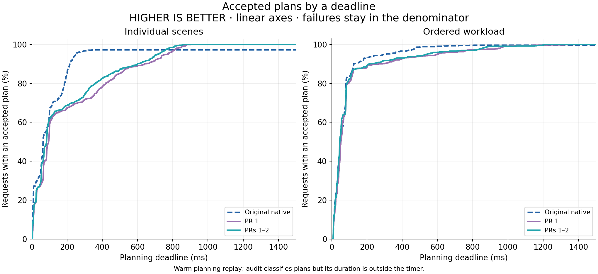

motionplan: prepare native FK and batch IK objective evaluations

Repeated IK evaluations traverse the same frame structure and create temporary poses. This PR prepares native transform traversal, evaluates objective/gradient inputs in batches, and reuses invocation-private scratch. Its expected mechanism is less arithmetic, traversal and allocation per IK evaluation.

**PR 2 of 4.** Branch `jake/native-2-kinematics` at `6a1590932f85`, targeting `jake/native-1-correctness`. [Stack overview and whole-stack result](README.md). Diff: runtime **+376/−14**, tests/fixtures **+634/−0**, 13 files. No reports, charts or benchmark infrastructure land in this PR.

Cumulative change versus **original native**: scenes +120.2% (+103.16 ms/request; exploratory 95% interval +116.8% to +124.1%); ordered +36.8% (+28.34 ms/request; exploratory 95% interval +32.3% to +39.0%). Accepted plans: original scenes 802/825, ordered 879/882; this head scenes 825/825, ordered 882/882. Fast invalid returns remain in the timing denominator.

Measured complete-planning change versus its preceding head: **individual scenes -9.8% (-20.59 ms/request; exploratory 95% interval -11.6% to -6.6%); ordered workload -7.5% (-8.53 ms/request; exploratory 95% interval -12.1% to -4.3%)**. Negative means less time. This cohort has 3 independent matched process blocks; inference is exploratory.

| Workload / variant | Accepted / attempts | Total s | Median ms | p95 ms | p99 ms |
|---|---:|---:|---:|---:|---:|
| Individual scenes: Original native | 802 / 825 | 70.809 | 62.75 | 229.38 | 274.27 |
| Individual scenes: PR 1 | 825 / 825 | 172.904 | 94.73 | 768.16 | 856.40 |
| Individual scenes: PRs 1–2 | 825 / 825 | 155.918 | 83.42 | 713.79 | 810.62 |
| Ordered workload: Original native | 879 / 882 | 67.975 | 51.35 | 292.44 | 503.84 |
| Ordered workload: PR 1 | 882 / 882 | 100.491 | 51.38 | 597.07 | 978.76 |
| Ordered workload: PRs 1–2 | 882 / 882 | 92.972 | 45.23 | 538.92 | 906.00 |

- Prepare FK paths once, retaining fallback for unsupported/custom frames and goal-cloud semantics.
- Batch objective and gradient evaluations with private scratch for each concurrent invocation.
- Add native quaternion point-transform and normalization fast paths.
- Test native pose/objective/gradient parity, joint limits, both-arm relative transforms, mimic models, position-only goals, goal clouds, custom fallback, cancellation and scratch ownership.

Per-request preparation costs time and may not amortize for easy direct requests. Small arithmetic differences can change IK branches, race winners and future cached routes. Correctness prerequisites now precede this PR: the initial extraction’s faster but invalid intermediate is retained as diagnostic evidence and is not this PR’s claimed win.

Percentile is on the horizontal axis, milliseconds on the vertical axis, both linear. Original native is first; the other curves show the preceding head and this cumulative head. These are complete planning calls, not kernel timings.

Pointwise process-block intervals preserve pairing and cache dependence. They are not simultaneous bands or multiple-comparison-adjusted significance results. Tail observations are sparse; inspect the full distribution and every independent process.

Path-quality comparison with preceding head: sequence/063-153628.349-serving-move.json: path-length p95 17.8% longer; sequence/078-153807.814-grabbing_filter-move.json: path-length p95 10.2% longer. Against original: sequence/046-153535.297-adding_milk-move.json: path-length p95 17.1% longer; sequence/078-153807.814-grabbing_filter-move.json: path-length p95 10.2% longer. Joint-space length is not physical execution time.

The six relevant package suites pass on each cumulative head using Go 1.26.10, and configured lint passes against each head’s parent. Focused race checks cover the stack’s concurrent changes, including the corrected validation and cancellation paths. The first two heads’ moved interpolation expectations were checked again after correcting their placement. The observed Go 1.27 JSON round-trip failure also occurs on unchanged main; the complete test passes on the repository toolchain. Full validation and source-equivalence details are in [VALIDATION.md](evidence/VALIDATION.md).

The metric is warm planning replay through the actual motion-service `PlanMotion` call: IK, search, required validation, smoothing, final path construction and synchronous cleanup. Snapshot preparation, RPC, declared warmup, independent audit and hardware execution are excluded. This measures end-to-end planning within that boundary, not request-to-first-motion or physical completion.

Original native is always the primary baseline. All variants use ordinary native routing, default workers and automatic production calibration. Effective calibration varies across heads/processes, so these measurements include the production policy response; they do not isolate constant-budget implementation cost. Runs were serial under recorded desktop activity; no load-based exclusion or retry. Individual-scene headlines weight 11 unique requests equally; duplicate scene08 stays in the ledger with zero headline weight. Ordered results preserve a whole 98-request warmup followed by three dependent passes per process. Paired bootstrap intervals resample whole independent process blocks. All outcomes count; accepted-only distributions, per-process/per-input results, maxima, threshold counts, trajectories and audit accounting are retained. Dense audit is evidence at its resolution, not proof of continuous collision freedom.

Whole-stack context remains **21.7% less ordered planning time / 16.89 ms saved per request** versus original native, with uncertain 2.2% scene improvement and **26.0% worse ordered p99**. All 6,024 full-stack attempts passed the frozen audit. Do not add incremental percentages or pool the separate cohorts. [Complete evidence](evidence/corrected-boundaries/README.md) includes every outcome, accepted-only distributions, per-process/per-input results, path quality, environment, exact commands and hashes.
