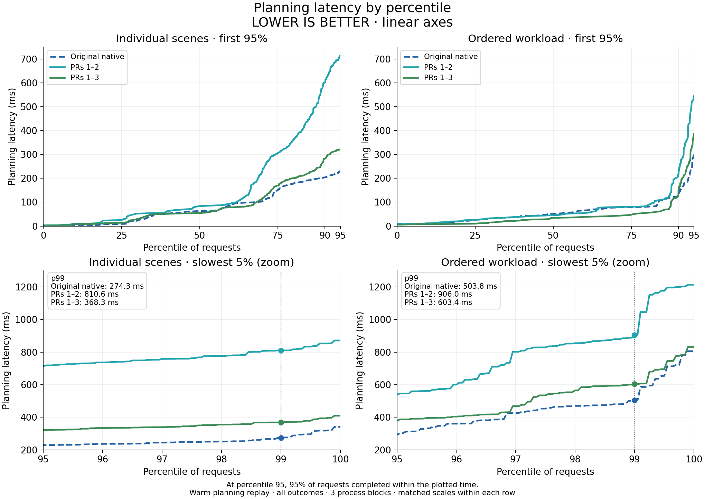
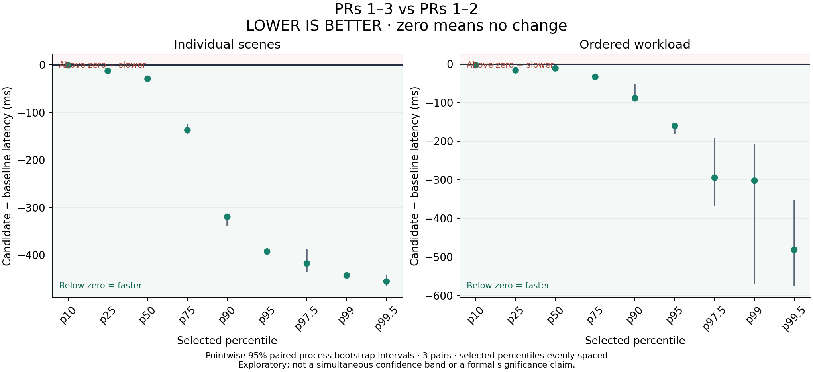
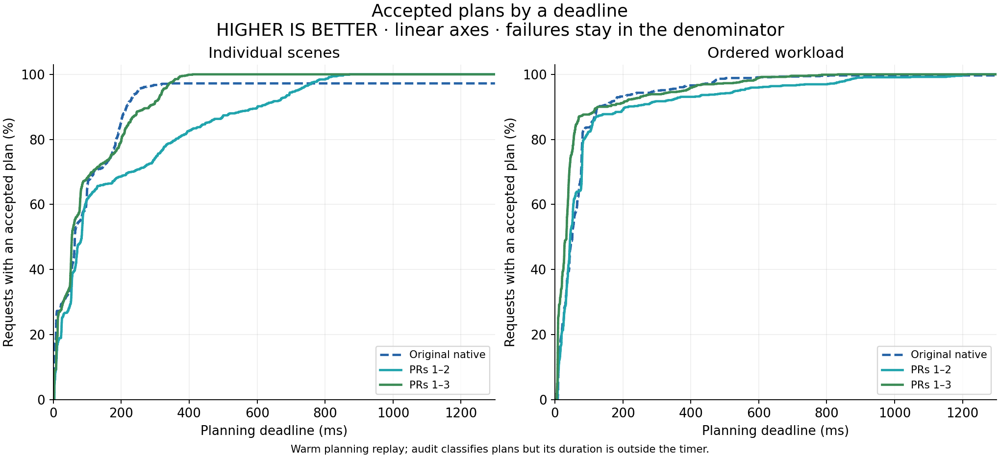

motionplan: stream conservative collision checks and reuse scene preparation

After PR1 restores required collision fidelity, this PR reduces repeated geometry and checking work with shared transforms, streaming interpolation and certified motion bounds. It also retains scene distance fields across requests within a fixed memory budget.

**PR 3 of 4.** Branch `jake/native-3-collision` at `899cedca5585`, targeting `jake/native-2-kinematics`. [Stack overview and whole-stack result](README.md). Diff: runtime **+1050/−87**, tests/fixtures **+1101/−1**, 25 files. No reports, charts or benchmark infrastructure land in this PR.

Cumulative change versus **original native**: scenes +16.9% (+14.48 ms/request; exploratory 95% interval +16.2% to +17.2%); ordered -14.3% (-11.00 ms/request; exploratory 95% interval -14.7% to -13.5%). Accepted plans: original scenes 802/825, ordered 879/882; this head scenes 825/825, ordered 882/882. Fast invalid returns remain in the timing denominator.

Measured complete-planning change versus its preceding head: **individual scenes -46.9% (-88.69 ms/request; exploratory 95% interval -48.1% to -46.0%); ordered workload -37.3% (-39.34 ms/request; exploratory 95% interval -38.7% to -35.4%)**. Negative means less time. This cohort has 3 independent matched process blocks; inference is exploratory.

| Workload / variant | Accepted / attempts | Total s | Median ms | p95 ms | p99 ms |
|---|---:|---:|---:|---:|---:|
| Individual scenes: Original native | 802 / 825 | 70.809 | 62.75 | 229.38 | 274.27 |
| Individual scenes: PRs 1–2 | 825 / 825 | 155.918 | 83.42 | 713.79 | 810.62 |
| Individual scenes: PRs 1–3 | 825 / 825 | 82.751 | 54.67 | 321.47 | 368.34 |
| Ordered workload: Original native | 879 / 882 | 67.975 | 51.35 | 292.44 | 503.84 |
| Ordered workload: PRs 1–2 | 882 / 882 | 92.972 | 45.23 | 538.92 | 906.00 |
| Ordered workload: PRs 1–3 | 882 / 882 | 58.270 | 33.94 | 378.53 | 603.37 |

- Share FK between cover evaluation and exact geometry; reuse geometry buffers with explicit ownership.
- Stream the required sample grid, skipping checks only when conservative bounds certify them; retain dense fallback for unsupported or uncertain cases.
- Use exact collision-allowance masks and avoid repeating hinted pairs already checked.
- Coalesce concurrent scene-field builds and bound retention by bytes and entries.
- Test numerical boundaries, both-arm relative motion, custom frames/callbacks, collision hints, interpolation, ownership, eviction and coalescing.

The scene cache allows **512 MiB and 128 entries**, replacing an eight-entry cap. Build scratch and other process memory are additional. This default needs review for robot hardware; reducing it can reduce sequence reuse. This PR combines collision implementation and cache changes, so its complete planning gain cannot be assigned to cache reuse alone without a separate ablation. Cumulative production code is unchanged from the six-block experiment.

Percentile is on the horizontal axis, milliseconds on the vertical axis, both linear. Original native is first; the other curves show the preceding head and this cumulative head. These are complete planning calls, not kernel timings.

Pointwise process-block intervals preserve pairing and cache dependence. They are not simultaneous bands or multiple-comparison-adjusted significance results. Tail observations are sparse; inspect the full distribution and every independent process.

Path-quality comparison with preceding head: sequence/004-153143.958-tamping-move.json: path-length p95 10.8% longer. Against original: scenes/scene05.json: path-length p95 10.6% longer; scenes/scene09.json: path-length p95 18.8% longer; sequence/078-153807.814-grabbing_filter-move.json: path-length p95 10.2% longer. Joint-space length is not physical execution time.

The six relevant package suites pass on each cumulative head using Go 1.26.10, and configured lint passes against each head’s parent. Focused race checks cover the stack’s concurrent changes, including the corrected validation and cancellation paths. The first two heads’ moved interpolation expectations were checked again after correcting their placement. The observed Go 1.27 JSON round-trip failure also occurs on unchanged main; the complete test passes on the repository toolchain. Full validation and source-equivalence details are in [VALIDATION.md](evidence/VALIDATION.md).

The metric is warm planning replay through the actual motion-service `PlanMotion` call: IK, search, required validation, smoothing, final path construction and synchronous cleanup. Snapshot preparation, RPC, declared warmup, independent audit and hardware execution are excluded. This measures end-to-end planning within that boundary, not request-to-first-motion or physical completion.

Original native is always the primary baseline. All variants use ordinary native routing, default workers and automatic production calibration. Effective calibration varies across heads/processes, so these measurements include the production policy response; they do not isolate constant-budget implementation cost. Runs were serial under recorded desktop activity; no load-based exclusion or retry. Individual-scene headlines weight 11 unique requests equally; duplicate scene08 stays in the ledger with zero headline weight. Ordered results preserve a whole 98-request warmup followed by three dependent passes per process. Paired bootstrap intervals resample whole independent process blocks. All outcomes count; accepted-only distributions, per-process/per-input results, maxima, threshold counts, trajectories and audit accounting are retained. Dense audit is evidence at its resolution, not proof of continuous collision freedom.

Whole-stack context remains **21.7% less ordered planning time / 16.89 ms saved per request** versus original native, with uncertain 2.2% scene improvement and **26.0% worse ordered p99**. All 6,024 full-stack attempts passed the frozen audit. Do not add incremental percentages or pool the separate cohorts. [Complete evidence](evidence/corrected-boundaries/README.md) includes every outcome, accepted-only distributions, per-process/per-input results, path quality, environment, exact commands and hashes.
