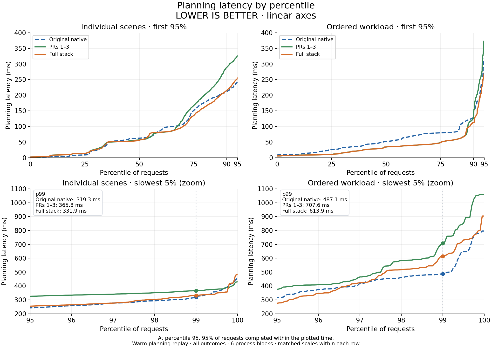
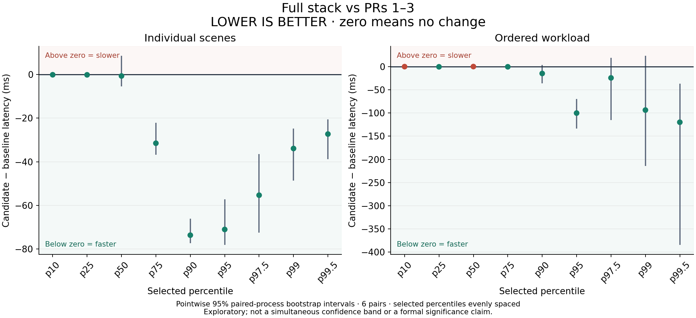
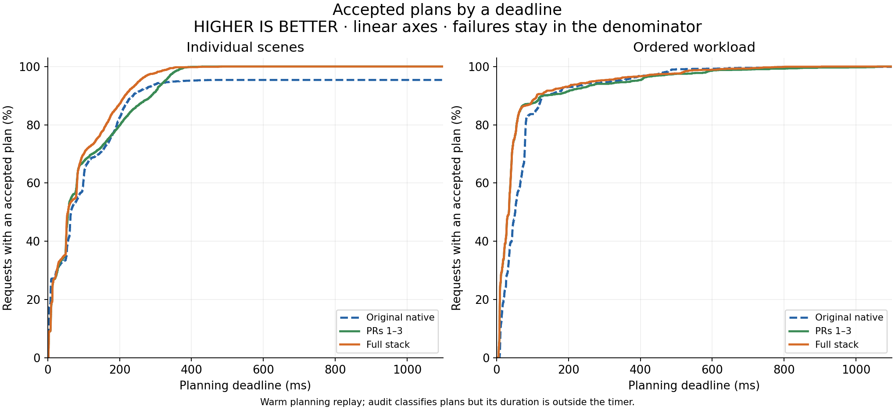

motionplan: bound optional finishing and reuse exact collision states

Finishing can keep refining shortcuts after a usable route exists. This PR bounds optional refinement, skips trials that cannot change inputs, rejects invalid shortcuts early, and reuses exact checked states within finishing. Required cleanup and final validation remain inside planning.

**PR 4 of 4.** Branch `jake/native-4-finishing` at `76654f793a75`, targeting `jake/native-3-collision`. [Stack overview and whole-stack result](README.md). Diff: runtime **+540/−48**, tests/fixtures **+978/−0**, 19 files. No reports, charts or benchmark infrastructure land in this PR.

Cumulative change versus **original native**: scenes -2.2% (-1.96 ms/request; exploratory 95% interval -4.6% to +0.8%); ordered -21.7% (-16.89 ms/request; exploratory 95% interval -24.4% to -18.7%). Accepted plans: original scenes 3,148/3,300, ordered 1,762/1,764; this head scenes 3,300/3,300, ordered 1,764/1,764. Fast invalid returns remain in the timing denominator.

Measured complete-planning change versus its preceding head: **individual scenes -14.7% (-15.01 ms/request; exploratory 95% interval -17.4% to -11.1%); ordered workload -10.8% (-7.36 ms/request; exploratory 95% interval -13.7% to -7.9%)**. Negative means less time. This cohort has 6 independent matched process blocks; inference is exploratory.

| Workload / variant | Accepted / attempts | Total s | Median ms | p95 ms | p99 ms |
|---|---:|---:|---:|---:|---:|
| Individual scenes: Original native | 3,148 / 3,300 | 293.580 | 62.33 | 242.10 | 319.28 |
| Individual scenes: PRs 1–3 | 3,300 / 3,300 | 336.638 | 56.67 | 325.50 | 365.81 |
| Individual scenes: Full stack | 3,300 / 3,300 | 287.114 | 55.99 | 254.46 | 331.88 |
| Ordered workload: Original native | 1,762 / 1,764 | 137.054 | 51.63 | 317.46 | 487.06 |
| Ordered workload: PRs 1–3 | 1,764 / 1,764 | 120.235 | 34.17 | 375.34 | 707.56 |
| Ordered workload: Full stack | 1,764 / 1,764 | 107.259 | 34.31 | 275.17 | 613.91 |

- Distinguish independent input owners from attached geometry when deciding which smoothing trials can help.
- Budget optional refinement by required sample work and cap guarded trials, retaining quality checks and fallback.
- Reuse exact states only within a bounded finishing scope; keys own complete frame names, widths and float bits.
- Retain mandatory cleanup/final validation and the accepted-edge sample grid; reject invalid candidates early.
- Test budget exhaustion, rejected/guarded trials, fallback, thin interior collisions, attached geometry and custom-frame behavior.

Less refinement can mean longer paths and slower physical execution. The budget bounds optional work, not complete request wall time; rejected trials still cost work. Exact-state memoization caps key payload at **4 MiB / 8,192 entries**, excluding map overhead. Cumulative production code is byte-identical to the measured full stack after documented formatting equivalence.

Percentile is on the horizontal axis, milliseconds on the vertical axis, both linear. Original native is first; the other curves show the preceding head and this cumulative head. These are complete planning calls, not kernel timings.

Pointwise process-block intervals preserve pairing and cache dependence. They are not simultaneous bands or multiple-comparison-adjusted significance results. Tail observations are sparse; inspect the full distribution and every independent process.

Path-quality comparison with preceding head: No within-input accepted path-length p95 exceeded the comparator by the declared 10% review threshold. Against original: scenes/scene04.json: path-length p95 11.7% longer. Joint-space length is not physical execution time.

The six relevant package suites pass on each cumulative head using Go 1.26.10, and configured lint passes against each head’s parent. Focused race checks cover the stack’s concurrent changes, including the corrected validation and cancellation paths. The first two heads’ moved interpolation expectations were checked again after correcting their placement. The observed Go 1.27 JSON round-trip failure also occurs on unchanged main; the complete test passes on the repository toolchain. Full validation and source-equivalence details are in [VALIDATION.md](evidence/VALIDATION.md).

The metric is warm planning replay through the actual motion-service `PlanMotion` call: IK, search, required validation, smoothing, final path construction and synchronous cleanup. Snapshot preparation, RPC, declared warmup, independent audit and hardware execution are excluded. This measures end-to-end planning within that boundary, not request-to-first-motion or physical completion.

Original native is always the primary baseline. All variants use ordinary native routing, default workers and automatic production calibration. Effective calibration varies across heads/processes, so these measurements include the production policy response; they do not isolate constant-budget implementation cost. Runs were serial under recorded desktop activity; no load-based exclusion or retry. Individual-scene headlines weight 11 unique requests equally; duplicate scene08 stays in the ledger with zero headline weight. Ordered results preserve a whole 98-request warmup followed by three dependent passes per process. Paired bootstrap intervals resample whole independent process blocks. All outcomes count; accepted-only distributions, per-process/per-input results, maxima, threshold counts, trajectories and audit accounting are retained. Dense audit is evidence at its resolution, not proof of continuous collision freedom.

Whole-stack context remains **21.7% less ordered planning time / 16.89 ms saved per request** versus original native, with uncertain 2.2% scene improvement and **26.0% worse ordered p99**. All 6,024 full-stack attempts passed the frozen audit. Do not add incremental percentages or pool the separate cohorts. [Complete evidence](evidence/full-stack/README.md) includes every outcome, accepted-only distributions, per-process/per-input results, path quality, environment, exact commands and hashes.
