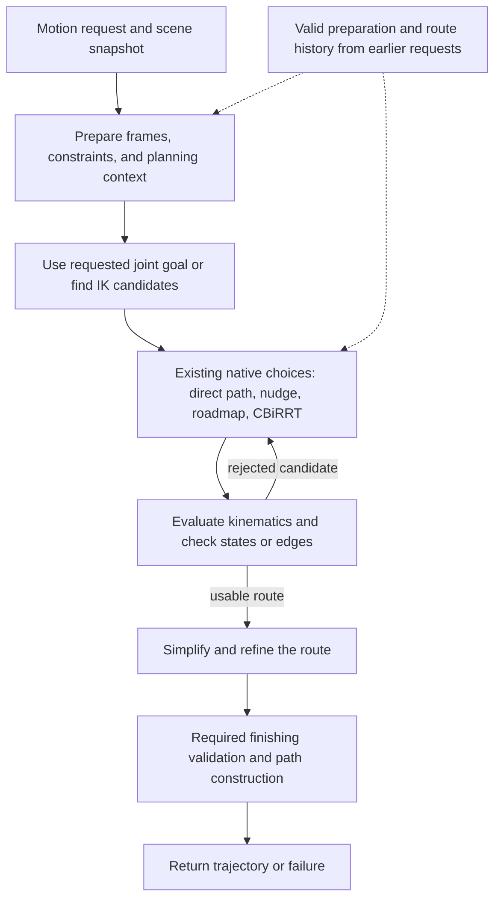
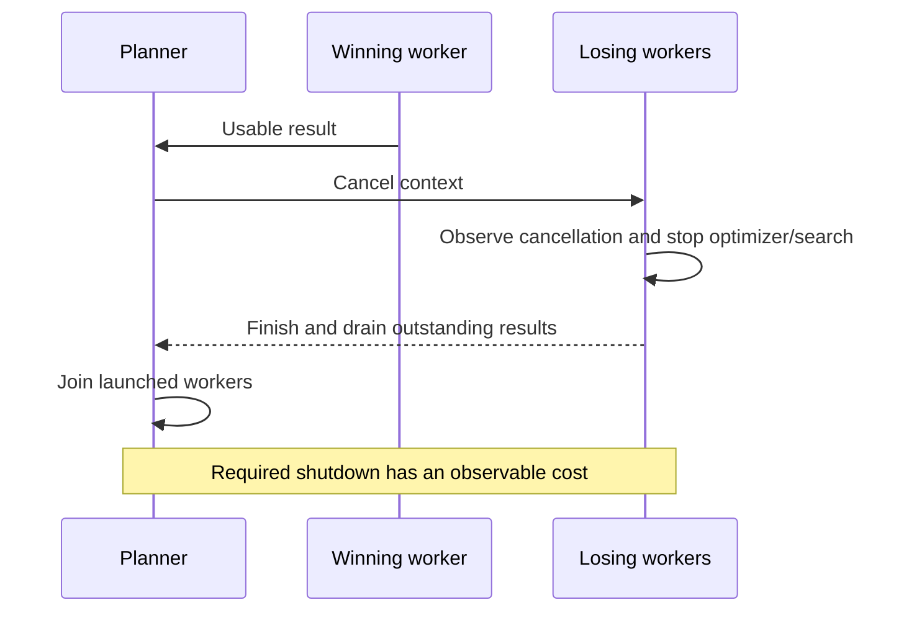
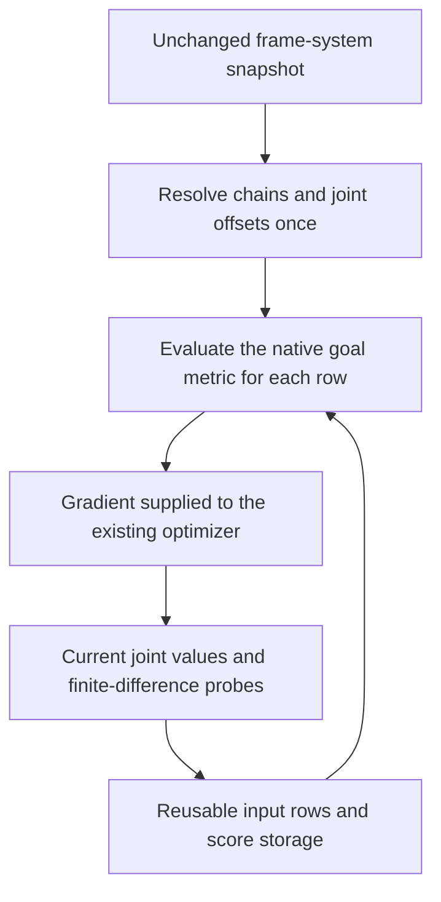
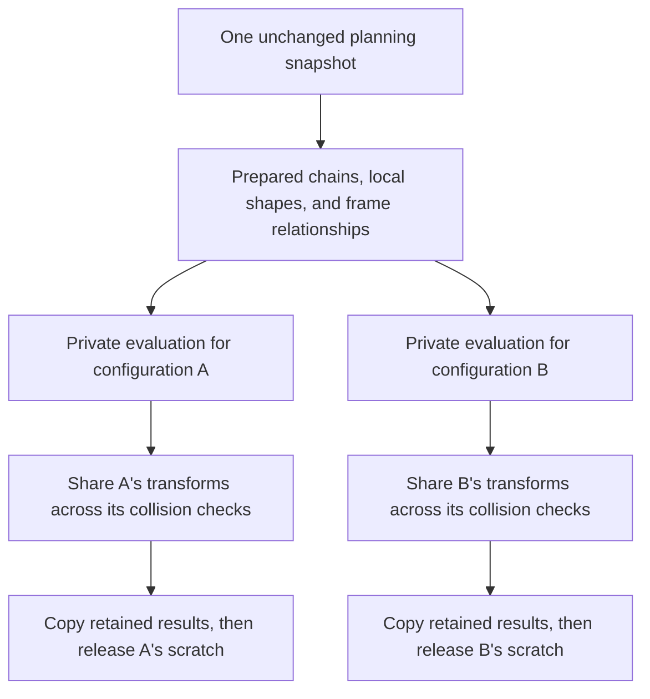
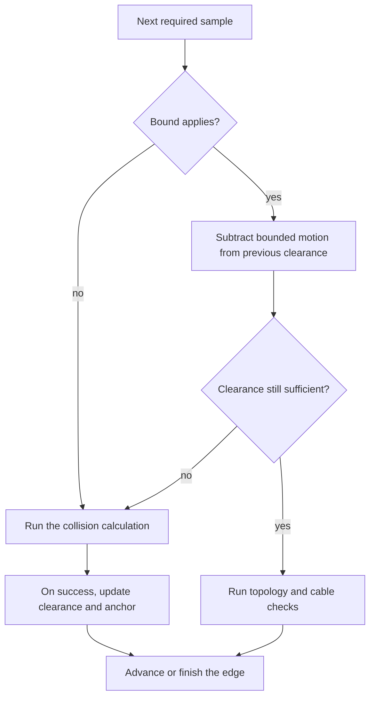
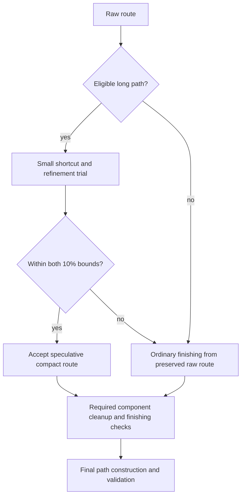
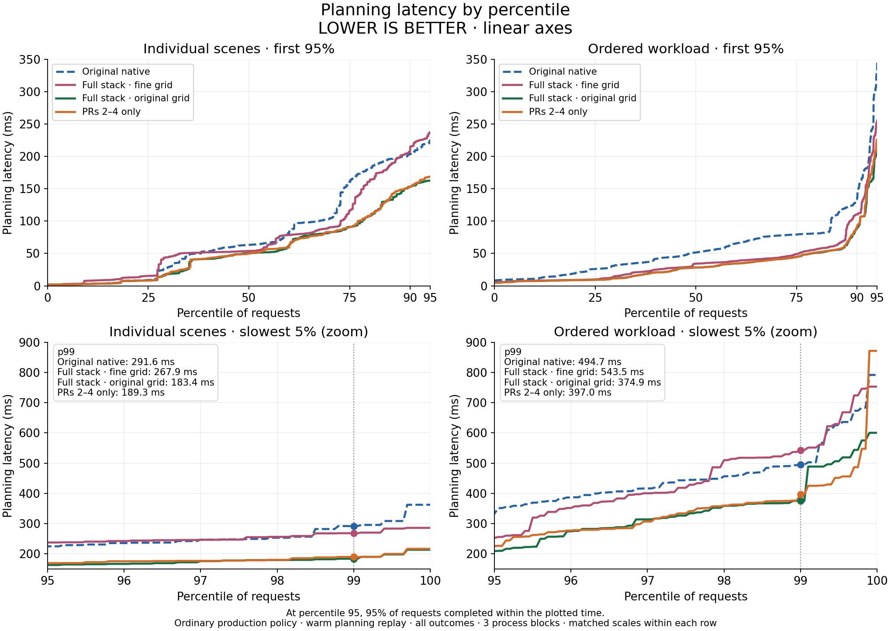
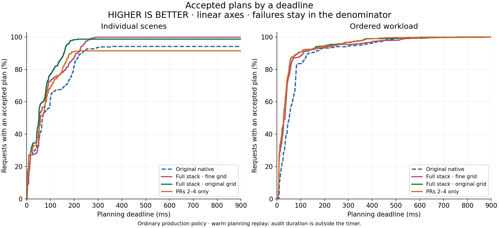

# Native motion planning: design, evidence, and open decisions

This walkthrough explains the four proposed native-planning PRs for someone who needs to discuss their engineering rationale with an RDK maintainer. It distinguishes existing RDK behavior, proposed implementation changes, policy choices, and measured results. It is a design discussion, not a recommendation to merge the stack unchanged.

**The proposal:** keep native planning's existing route-selection machinery; make its repeated kinematics and collision work cheaper; retain expensive preparation when its inputs remain valid; and spend less effort on optional path refinement. Decide collision-sampling fidelity separately. A better benchmark result does not, by itself, establish the correctness or value of each mechanism.

The latest matched comparison starts with **original native: 77.95 ms/request** on the ordered workload. The full stack took **58.40 ms** with the proposed finer sampling, or **48.14 ms** with the original sampling rule. Those are **25.1% and 38.2% reductions in whole warm planning replay time**, respectively. The strict auditor rejected **27, 0, and 10 plans**, respectively, out of 1,572 attempts per variant including warmup. These are exploratory corpus observations, not a general accuracy guarantee or physical robot execution timings.

The code explanation is pinned to full-stack commit [`76654f793a75`][head]. The four drafts start from upstream `8ab5892be`; the separate [collision repro PR against upstream RDK][repro-pr] was validated on newer upstream `dc656d012`. The November 19 sampling experiment is separate from the earlier extraction experiments. Do not combine their observations or multiply their incremental percentages.

## Reading map

Allow about 30 minutes for the full walkthrough. For a first discussion, read sections 1–2, the sampling example in 3.4, the evidence in 8, and the decisions in 9; then use the per-PR sections and code map for deeper review.

1. [What the existing planner does](#1-what-the-existing-planner-does)
2. [What kinds of change are in the stack](#2-what-kinds-of-change-are-in-the-stack)
3. [PR1: cache validity, worker lifetime, and sampling](#3-pr1-cache-validity-worker-lifetime-and-sampling)
4. [PR2: prepared kinematics and batched IK evaluation](#4-pr2-prepared-kinematics-and-batched-ik-evaluation)
5. [PR3: collision work and scene preparation](#5-pr3-collision-work-and-scene-preparation)
6. [PR4: bounded finishing and exact state reuse](#6-pr4-bounded-finishing-and-exact-state-reuse)
7. [Why the changes interact](#7-why-the-changes-interact)
8. [What the experiments establish](#8-what-the-experiments-establish)
9. [The direction to discuss with Dan](#9-the-direction-to-discuss-with-dan)
10. [A short explanation you can give aloud](#10-a-short-explanation-you-can-give-aloud)
11. [Code-reading and validation map](#11-code-reading-and-validation-map)

Diagrams use Mermaid, which [GitHub renders in Markdown files][github-mermaid]. They are explanatory schematics, not exact function-call traces.

## 1. What the existing planner does

A **configuration** is a collection of joint values: angles for rotational joints and distances for translational joints. A **pose** describes a position and orientation. A **frame system** describes how components, joints, links, tools, and reference frames relate to one another.

**Forward kinematics (FK)** maps a configuration to poses. Given six joint angles, where are the tool and each robot link? **Inverse kinematics (IK)** searches for configurations that achieve a requested pose. Several configurations may reach the same tool pose, and they can have very different collision behavior and route lengths.

A **state check** asks whether one configuration satisfies the constraints. An **edge check** asks whether the motion between two configurations is acceptable. Clear endpoints do not establish that the connecting motion is clear. The implementation samples intermediate configurations and checks them, with additional mechanisms that can avoid redundant collision calculations.

Native planning already contains direct-path attempts, nudging, reused roadmaps, and CBiRRT search. A roadmap is a retained graph of configurations and connections that can help later requests. CBiRRT is the constrained bidirectional search used for harder cases. These capabilities are part of the baseline; the four-PR stack must not take credit for introducing them.



Kinematics and collision checking occur inside repeated loops, including IK, search, and finishing. That is why reducing overhead there can affect a complete planning call. But a faster primitive does not tell us how many times the planner will call it, which search worker will win, or what route will be retained for the next request.

The desired robot outcome extends beyond this diagram: a robot should begin useful motion sooner and complete the task sooner. Planning latency contributes to that outcome, but RPC, snapshot creation, dispatch, controller behavior, and trajectory execution also matter. A route that is faster to compute can take longer to execute.

## 2. What kinds of change are in the stack

The four PR boundaries are not four homogeneous ideas. There are several different engineering arguments:

| Kind of change | Example | Argument needed for review |
|---|---|---|
| Repair an invalid reuse or lifetime assumption | An unchecked endpoint must not become certified by a cached prefix check | Show a concrete failing case and the corrected validity/lifetime rule |
| Reduce cost while preserving the intended calculation | Prepare a frame chain once; reuse interpolation storage | Show equivalent supported behavior, ownership rules, and fallback |
| Avoid work using a geometric bound | Skip a collision calculation while a valid clearance bound remains positive | Derive the bound and establish its assumptions and numerical scope |
| Trade retained memory for repeated-request speed | Retain more scene distance fields | Define identity, invalidation, concurrency, memory limits, and workload benefit |
| Change optional work policy | Stop some refinement after a work budget | Measure latency together with final path quality and execution consequences |
| Change checking fidelity | Add a 0.002-radian interpolation cap | Agree the desired accuracy contract and quantify its cost |

An implementation-preserving optimization still needs careful review. It can contain an arithmetic or ownership bug, and a timing change can alter concurrent search outcomes. Conversely, an intentional policy change is not automatically wrong; it simply requires an explicit tradeoff decision rather than an equivalence claim.

**A correction to the earlier review narrative:** the finer sampling rule was described as restoring “required” fidelity. We have real missed-collision repros, but we have not established that this particular global angular cap is the required production policy. That distinction is central to this discussion.

## 3. PR1: cache validity, worker lifetime, and sampling

### 3.1 Edge validity belongs to a checking context

Suppose an edge goes from configuration A to configuration B. One caller checks the interior but intentionally excludes B, because another operation handles that endpoint. Another caller later asks whether the entire edge, including B, is valid.

If the cache stores only “A to B is clear,” the second caller can inherit a conclusion that was never checked. Similar problems arise when a later segment changes constraints, or when the edge is traversed in the reverse direction under a different endpoint policy.

PR1 moves native edge-result reuse into the segment context and includes the checker, direction, resolution, and endpoint-inclusion policy in the key. The geometric endpoints are represented by their existing input hashes. A changed checker must not reuse the old checker's result. A canceled request also must not become successful merely because a cache lookup hits.

This is independent of sampling density. Even an arbitrarily dense prefix check does not certify its excluded endpoint. It is also worth being precise: extending a hash-based key's scope does not turn the cache into a formal collision-proof identity system. The change fixes the demonstrated context aliasing; it does not prove hashes cannot collide.

See [segment context and edge cache][context] and the [cache-scope regression tests][path-tests].

### 3.2 Geometry identity and mesh preparation have different lifetimes

A scene cache must distinguish an obstacle whose dimensions or vertices changed, even if its name and pose did not. The earlier shape hash was too coarse for this purpose. PR1 fingerprints built-in shape dimensions and mesh vertices at floating-point precision in addition to the existing identity fields. That prevents demonstrated stale reuse after geometry changes; arbitrary custom geometry still needs its documented hashing behavior.

A mesh also contains preparation that depends only on its fixed geometry, such as its bounding-volume hierarchy (BVH), a tree used to prune triangle comparisons. Repeatedly discarding that immutable preparation makes later queries rebuild it. PR1 keeps the BVH and deduplicated vertices with the mesh while clearing transient collision hints. Replacing/unmarshalling mesh data invalidates the corresponding preparation and identity.

There are two distinct choices here: correct invalidation after replacement, and longer retention of immutable preparation. The latter trades memory lifetime for reuse. Changing what `ResetCache` releases needs maintainer agreement; it should not be presented as a free or purely cosmetic fix.

See [geometry identity][geometry] and [mesh lifetime][mesh].

### 3.3 A winning result and stopped workers are different events

Native search can race several workers. Once one succeeds, cancellation asks the others to stop. Cancellation is cooperative: it does not forcibly terminate arbitrary computation.

There were two relevant shutdown concerns. An IK consumer could drain results before signaling cancellation, leaving the producer doing unnecessary work. And a planner could return while losing search workers were still alive. PR1 signals cancellation before draining IK output, asks NLopt to stop from its own objective callback, and joins launched search workers. The results channel is large enough for losing senders to finish even with a larger worker override.



This is ownership of work, not removal of CPU cores. Joining workers can increase the current call's synchronous latency. Prompt cancellation can reduce that cost and prevent abandoned work from competing with the next request. We should measure both result availability and required shutdown when diagnosing this mechanism, rather than assuming waiting is always faster.

The original frozen executable and the literal PRs-2–4 variant do not join all losing search workers. Their asynchronous shutdown time is unavailable in the reported call-return interval. That limitation remains explicit in the comparison.

See [IK producer/drain ordering][node], [NLopt cancellation][nlopt], and [search-worker lifetime tests][lifetime-tests].

### 3.4 Finer sampling is a separate accuracy decision

The existing grid uses endpoint pose changes and joint-limit-derived increments. Those quantities do not directly bound the displacement of every point on every link. A one-degree rotation moves a point one metre from the axis by roughly 17.5 mm, even if the joint origin does not translate. With two moving links, their relative closing motion matters too.

PR1 removes the old clearance-skipping heuristic and adds a joint-aware interpolation rule with an angular cap of **0.002 radians, about 0.115 degrees**. These are separate changes. Removing an unsafe skip cannot find a collision if none of the underlying samples intersect it. More samples also do not establish continuous collision freedom.

The angular cap is not a universal 2 mm spatial error bound: link lengths, multiple rotating joints, tools, and coupled motion affect point displacement. The helper retains linear units for prismatic motion and falls back for unsupported frames.

The recorded wrist example makes the question concrete:

| Setting on the same saved edge | States in the grid | Result on unchanged upstream |
|---|---:|---|
| Buffer `1e-8` mm; resolution `2` | 45 | Segment accepted; all grid states clear |
| Buffer `1` mm; resolution `2` | 45 | Segment rejected |
| Buffer `1e-8` mm; resolution `0.1` | 880 | Segment rejected |

At interpolation fraction 0.42, direct box geometry checks show a signed wrist/obstacle distance of approximately **−0.292 mm**, including a collision check with zero buffer. The finer angular-cap implementation samples this edge at 112 states and rejects it too. These are different ways of catching this particular witness, not equivalent general guarantees.

A larger buffer asks for more clearance. It does **not** permit that much penetration. It may catch a near-obstacle configuration at an existing sample, but can also make narrow routes infeasible. Sampling resolution and buffer therefore interact, yet they are not interchangeable accuracy settings.

The [upstream test-only PR][repro-pr] also includes two rotating links whose small spheres coincide between samples. Both repros fail consistently on upstream; the buffer/resolution controls pass. These tests provide concrete inputs for deciding the contract. They do not settle the desired default.

## 4. PR2: prepared kinematics and batched IK evaluation

### 4.1 Prepare the structure that stays constant

During a request, most robot-model structure is unchanged: frame parents, joint axes, fixed transforms, and where each joint value lives in the configuration vector. IK repeatedly changes the joint values and asks for another pose.

`PreparedTransform` resolves the supported frame chains and input offsets once, then evaluates them with new inputs. It handles native fixed, rotational, translational, model, and supported mimic structure. Relative-frame goals require both sides of the transform, not just a world-frame tool position.

The expected benefit is less repeated lookup, traversal setup, and allocation. The robot's kinematic model and goal metric are intended to remain the same. Prepared objects belong to an unchanged snapshot; reusing them after a model or frame-system mutation would invalidate that argument.

Unsupported preparation falls back to the normal evaluator. Goal clouds retain their existing region-membership semantics rather than being treated as ordinary point goals.

### 4.2 Batch the repeated objective evaluations

For a six-joint robot, a finite-difference gradient typically needs an objective evaluation at the current vector and at six perturbed vectors. Conceptually:

```text
f(q), f(q + delta_1), ..., f(q + delta_6)

gradient_i ≈ (f(q + delta_i) - f(q)) / actual_probe_step_i
```

The probe step can change near joint bounds. The batch path must preserve those probe semantics, not assume every perturbation remains a positive constant.

PR2 prepares the input rows and score storage for each optimizer solve. The objective evaluates those rows through the prepared transforms and the native distance metric. Storage is reused rather than rebuilding an evaluation's surrounding objects for every row.



Batching here is CPU-side organization of the same mathematical work. It is not GPU execution, new parallel search policy, or elimination of the seven pose evaluations. Each invocation's mutable scratch must remain private to avoid one concurrent IK worker overwriting another's pose.

### 4.3 Avoid arithmetic whose result would be discarded

The PR also narrows two dual-quaternion operations. Point extraction computes the needed dual part without calculating an unused real part. Rotation composition checks a tight squared-norm window around a unit quaternion before calling the more expensive robust normalization calculation. Inside that window, the existing normalization policy would leave the components unchanged; boundary, extreme, and non-finite cases retain the original arithmetic.

This is an intended equivalence argument, not permission to casually approximate rotations. Numerical-boundary and parity tests matter because tiny differences can change IK convergence, collision outcomes near contact, or which concurrent candidate wins.

A useful explanation to Dan is: **we prepare unchanged structure and avoid redundant surrounding work while keeping the existing solver and objective.** We still need to defend support coverage, immutability, and arithmetic parity. Equal inputs do not promise an identical final path when scheduling and search races are involved.

See [prepared transforms][prepared-transform], [goal-cost evaluation][goal-cost], [batch integration][nlopt], and [dual-quaternion changes][dual-quaternion].

## 5. PR3: collision work and scene preparation

This PR contains several mechanisms. Its measured end-to-end effect is the effect of their combination; it is not a measurement of each mechanism independently.

### 5.1 Stream the same interpolation samples

An eager checker allocates a complete collection of intermediate configurations, then visits them. A streamed checker can construct each required configuration into private reusable storage as it is needed, and stop after the first failure.

For recognized native interpolation, PR3 preserves the grid's count, interpolation arithmetic, and endpoint policy. It changes storage and traversal work. Custom interpolation uses the ordinary eager path to preserve its behavior and error ordering.

The hazard is ownership. A returned sample is borrowed storage: the next interpolation overwrites it. A retained waypoint or a valid-prefix result must receive a copy. Tests must exercise that lifetime, not just compare one sample in isolation.

See [segment samples][segment-samples] and [prepared interpolation][prepared-interpolation].

### 5.2 Reuse geometry work within a state

A single configuration can undergo obstacle, robot-to-robot, and self-collision checks. Those checks can need overlapping frame transforms and shapes. Recomputing all of them separately spends work on identical inputs.

Prepared geometry records fixed local shapes and frame relationships. One state's private evaluation computes needed world transforms and materializes geometry on demand. Collision-cover evaluation can share that FK computation in the recognized native scope. Reusable transformed-shape buffers retain fixed shape information and update poses, clearing pose-dependent derived caches as necessary.

A new configuration must start with cleared per-state results. Borrowed geometry cannot survive release of its evaluation. Immutable mesh topology can be shared, but mutable transformed poses cannot be shared between concurrent evaluations. Unknown geometry types retain their ordinary transform implementation, and custom behavior prevents shortcuts that would change its evaluation semantics.



This makes allocation reduction a plausible mechanism; it does not justify saying the checker makes zero allocations or that process memory necessarily shrinks.

See [prepared geometry][prepared-geometries], [geometry transform buffers][geometry-buffer], and [shared cover/state work][cover-state].

### 5.3 Make pair bookkeeping cheaper

Collision allowances—pairs explicitly exempt from collision checking—do not change at every sampled configuration. PR3 builds immutable lookup indexes once. For at most 64 named entries, bit masks implement exact membership; larger name sets use the map path. The bit mask changes the representation, not which pairs are allowed.

The checker also avoids repeating an ordered pair already checked by its “last colliding pair” hint within the same evaluation. It preserves pair direction where the underlying arithmetic is not guaranteed bit-symmetric and retains collect-all reporting behavior.

These are relatively local optimizations, but name collisions, unnamed shapes, allowed-pair semantics, and duplicate reporting need tests. Their individual whole-service benefit has not been established merely because the combined PR is faster.

See [collision pair handling and allowances][collision].

### 5.4 Skip collision calculations only with a usable motion bound

A previous clearance is useful only if we can bound how much geometry might move before the next check. Dividing a clearance by a nominal sampling resolution is insufficient when distant link points can move much farther than that resolution.

For ideal rigid-body interpolation, a point's displacement can be bounded using translation, rotation, and distance from the rotating axes. Along a frame chain, the implementation accumulates an upper bound of the form:

```text
child_linear_bound = parent_linear_bound
                   + parent_angular_bound * maximum_child_offset
                   + child_translation_bound

child_angular_bound = parent_angular_bound + child_angular_travel

point_bound = child_linear_bound + child_angular_bound * shape_extent
```

These bounds are with respect to interpolation fraction, **not seconds of physical execution**. Mimics, attached tools, branches outside the primary output chain, and prismatic extension contribute to the bound.

For two moving geometries, their possible movements add. The current validator conservatively uses twice the maximum point bound for relative closing motion. If a previous clearance is `d`, and the maximum relative movement since that check is `m`, then `d - m` is the candidate lower bound on clearance.

For example, start with 10 mm clearance. If each side can move by at most 3 mm, relative motion can close at most 6 mm, leaving a lower bound of 4 mm. With a required buffer of 1 mm, a valid bound can justify omitting the expensive collision calculation. If the bound instead permits 11 mm of closing motion, it says nothing useful; perform the check.



The implementation must also respect native floating-point behavior. Its mathematical rigid-body argument cannot simply ignore the native quaternion shortcuts near identity. Eligibility checks reject problematic numerical regimes, including relevant composed and relative rotations, and retain dense checking. There are also support/size/depth limits and a small extra margin for deciding whether to skip. That margin tightens skip eligibility; it is not a newly requested robot clearance.

This is one of the most demanding parts of the review. We need the derivation, a valid clearance quantity covering every relevant pair, correct numerical gating, and reliable fallback. Tests of numerical boundaries and two moving arms support that argument but do not constitute a formal floating-point proof.

Crucially, **certifying some skipped calculations does not turn the entire sampled validator into continuous collision detection**. Where no certificate applies, it still falls back to the selected discrete grid. An intersection between those fallback samples can remain undetected.

See [motion-bound construction][motion-bounds], [numerical eligibility][bound-numerics], and [application of the clearance bound][segment-samples].

### 5.5 Retain static-scene preparation across requests

The baseline already has a process-wide cache of scene distance fields. A signed distance field (SDF) provides spatial distance information used by the collision machinery. PR3 does not introduce this representation or make its existing 10 mm voxel grid coarser.

It changes the retention policy from an eight-entry cap to **up to 128 entries and an accounted 512 MiB budget**. Concurrent requests for the same missing scene join one field build rather than constructing duplicates. Geometry/pose identity still determines reuse. An oversized field can be used for the current operation without being retained in that cache.

The workload argument is straightforward: a sequence visiting more than eight recurring scenes can continually evict and rebuild useful preparation. A larger cache can avoid that repeated work. An isolated repeated scene may show little benefit because it already fits.

The tradeoff is equally concrete: memory and cache management. The budget is accounted retained field storage, not a cap on total process memory, build scratch, active references, or all mesh preparation. The chosen default needs review on robot hardware. Scene mutation must invalidate reuse. A hash fingerprint is not a mathematical proof of exact scene identity.

See [scene registry and build coalescing][collision-cache] and [SDF memory accounting][sdf].

## 6. PR4: bounded finishing and exact state reuse

Finding a usable route is not the end of planning. The finisher removes unnecessary waypoints, tightens detours, and handles motions involving multiple components. Those operations themselves create candidate edges that need validation.

PR4 changes how checks are performed and intentionally does less optional work. It must therefore be evaluated against both planning latency and the final path.

### 6.1 Bound optional refinement by prospective checking work

A count of shortcut attempts is an imperfect work budget: one candidate edge can require many more validation samples than another. PR4 charges optional refinement according to the candidate's full grid sample count, before validation, even if certificates or caches eventually make that check cheaper.

The initial optional sample budget is twice the raw path's sample work, clamped between **1,000 and 12,000**. The initial simplification/idle-component cleanup and the final validation do not consume this optional budget. Existing probe limits still apply where they did before.

This bounds a category of work, not total wall-clock planning time. Geometry complexity varies per sample; preparation, mandatory validation, and cleanup still cost time. The multiplier and limits are tuning choices. We have empirical results for the combined implementation, not a proof that these values are optimal.

### 6.2 Try a small, guarded simplification before ordinary finishing

For a sufficiently long raw path, a speculative pass tries a direct chord over a span. If blocked, it divides the span around a large configuration-space detour and tries smaller chords. It can then use the existing vertex-pulling and waypoint-removal operations. Accepted shortcuts still undergo the selected edge-validation rules.

The speculative path has a **32-probe** allowance and is accepted only when both its configured planner cost and whole-configuration Euclidean length fall within **10% of their direct endpoint lower bounds**, in the supported L2-metric case. Otherwise the ordinary finisher starts from the preserved raw path with its original fallback allowance. Failed speculation still consumed real computation; preserving an allowance does not refund elapsed time.



The 10% condition is frequently easy to overstate. It is **not** a guarantee that the final returned path is within 10% of original native, the previous PR, or a globally optimal executable trajectory. It applies to a speculative candidate between fixed endpoints. Different IK endpoints, later cleanup, metrics with mixed units, and route-history changes still require final path-quality measurement.

### 6.3 Reject bad shortcuts earlier without accepting them more cheaply by fiat

A shortcut caller often needs only “valid or invalid,” whereas a search caller may need the complete valid prefix of an edge. Those requirements permit different checking orders.

For an eligible native shortcut, PR4 checks selected existing grid positions around the midpoint, quarters, and finer subdivisions early. A blocked midpoint can reject a long candidate without first visiting its entire prefix. If those probes pass, the validator still covers the remaining required samples, allowing only the existing certificates/reuse mechanisms. This is an early-rejection optimization, not a coarse acceptance test.

Custom callbacks and unsupported interpolation keep their existing traversal behavior. Otherwise changing call order could alter side effects, error ordering, or retained references.

### 6.4 Avoid trials on attached geometry that cannot move independently

An arm may have many moving frames because tools and geometry are attached to its joints. Those frames are not all independent actuators. For recognized native frame systems, PR4 identifies actual input-owning frames for multi-component smoothing. This avoids optional experiments that cannot change any independent input. Opaque/custom frames retain the previous behavior.

### 6.5 Reuse successful collision results for exactly the same state

Finishing can encounter the same configuration more than once. PR4 allows reuse of a successful collision clearance in that finishing call tree, scoped to an immutable native checker within the request.

The key owns the complete frame names, input widths, and floating-point bits, including zero-DoF entries. A hash selects a shard; the map compares the full key. Non-finite inputs are ineligible. Topological checks run before a collision-cache lookup, and changing collision callbacks disables the shortcut. The limit is **8,192 entries and 4 MiB of retained key payload**, excluding map overhead.

This is stronger key equality than the older edge hash cache, and it has a different scope and purpose. It is not a process-wide promise that the same angles remain valid after the world changes. Although storage belongs to the planning request, lookups are enabled only in the finishing context; search does not use this optimization.

Required finishing validation can use those valid certificates and exact collision results; it is not an independent audit. The separate benchmark audit checks preserved trajectories outside the planning timer using original geometry arithmetic. Keeping those roles distinct prevents the optimized checker from being its own only evidence of correctness.

See [finishing budgets][finishing-budget], [guarded finishing][guarded-finishing], [span partitioning][shortcut-partition], [quality guard][shortcut-quality], [shortcut validation][shortcut-validation], [input-owning frames][input-smoothing], and [exact state cache][exact-state].

## 7. Why the changes interact

### There are several cache lifetimes

| Lifetime | What is reused | What must remain valid |
|---|---|---|
| One state evaluation | Frame transforms and transformed geometry | The input configuration and all borrowed-storage ownership |
| One edge/segment context | Sampling scratch, clearance anchor, edge verdicts | Edge parameters, checker, constraints, direction, endpoint policy |
| One request, with finishing-only lookup eligibility | Exact successful collision states | Native checker scope, complete state identity, unchanged snapshot |
| Across requests | Static-scene SDFs | Scene identity and retained-memory policy |
| Mesh/model lifetime | Immutable topology preparation | Geometry data has not been replaced |

“Add caching” is not a sufficient explanation. Each row has different invalidation, synchronization, memory, and ownership rules.

### Faster primitives can change the amount of work

Concurrent solvers race. A faster evaluator can change which candidate wins, which route gets smoothed, and which route enters history. That can affect every later request in an ordered workload. Even with the same seeds, scheduling can produce different paths.

Automatic startup calibration also changes effective planning budgets. In the November 19 cohort, the finer-grid full stack used a calibration multiplier of 0.2667, while the sampling-only removal used 0.2444. The comparison measures the ordinary-policy consequences of changing the sampling rule, including that calibration response. It is not a constant-budget estimate of per-sample cost.

### The useful insights were about repeated work and validity

The mechanisms that shaped the proposal were:

- Unchanged frame structure can be prepared separately from changing joint values.
- Several checks of one configuration can share transforms and geometry storage.
- Recurring scenes can make preparation retention more important than an isolated kernel improvement.
- Finishing can spend meaningful time after a usable route exists, but that work buys path quality.
- A nominal interpolation step is not a bound on every link point's motion.
- Changes in race winners can expose an existing checker weakness rather than create the geometric intersection themselves.
- The later direct experiment showed that tighter sampling was materially reducing the apparent speed gain; it should be an explicit design decision.

These are explanations for why the mechanisms are plausible and why the experimental design matters. We should not invent a quantitative attribution from them. In the separate checking-alternatives study, isolated conservative bounds/streaming changes did not establish an ordered-workload win over dense checking. That is a reason to examine their incremental benefit and complexity in the actual combined implementation, not to assign the entire PR3 gain to the bound machinery.

## 8. What the experiments establish

The latest matched sampling-policy experiment has three independent fresh processes per variant. Each process runs the same scene/seed schedule, then warms the full 98-request ordered sequence and measures three complete passes. A scene warmed individually is a different workload from a stateful sequence. The 882 ordered requests per variant represent three independent process histories, not 882 independent experiments.

Original native remains the primary baseline. The native selector is not forced into CBiRRT.

| Variant | Individual-scene mean | Ordered-workload mean | Ordered time vs original | Ordered p99 | Strict audit rejections / 1,572 attempts |
|---|---:|---:|---:|---:|---:|
| **Original native** | 87.25 ms | 77.95 ms | Baseline | 494.72 ms | 27 |
| Full stack, finer sampling | 82.94 ms | 58.40 ms | −25.07% | 543.50 ms | 0 |
| Full stack, original sampling rule | 61.57 ms | 48.14 ms | −38.24% | 374.92 ms | 10 |
| PRs 2–4, all of PR1 removed | 62.47 ms | 48.75 ms | −37.46% | 396.96 ms | 36 |

Latency columns include all outcomes. Individual-scene means use 330 measured requests across 11 equally weighted unique inputs; ordered means use 882. The rejection column additionally includes warmups and the duplicate scene, hence its different denominator. Per-process and per-input results, including conditional accepted-plan distributions, are in the linked report. The complete request ledger remains in the local experiment.

This directly supports two observations. Removing only finer sampling saved another **17.57% of ordered time** compared with the full finer-grid stack. Removing the rest of PR1 did not buy additional speed in this cohort and brought back independent regression failures. It does not prove that the original sampling policy is acceptable for the intended robot accuracy contract.



The exploratory 95% paired-process interval for the sampling-only variant's ordered reduction was **36.1–39.4%**. The observed p99 difference versus original was **−119.81 ms**, with a pointwise interval of **−147.66 to +38.85 ms**, so that particular tail improvement remains uncertain. These are three-process, multiple-endpoint exploratory results, not formal statistical significance or precise tail guarantees.

The finer-grid full stack's p99 worsened in this cohort despite its lower total time. The earlier six-block extraction also had a p99 regression: **21.7% less ordered time but 26.0% worse p99**. Those are separate cohorts, both retained. We cannot choose whichever tail result makes the story look better.

Paths changed too. Relative to the finer-grid full stack, the sampling-only variant increased ordered path-length p95 by **13.3% and 26.0% on two inputs**. Relative to original native, none of its ordered inputs exceeded the 10% p95 review flag; one individual scene did, at 10.6%. These are within-input joint-space lengths, with only nine observations per ordered input, not executed robot durations.



The measured boundary is the complete warm `PlanMotion` call through the motion-service replay: IK, search, required checking, finishing, path construction, and synchronous cleanup. Snapshot preparation, RPC, declared warmup, independent audit, and physical execution are outside the timer. Required implementation validation remains inside it. Missing asynchronous worker shutdown time in original/pr234 is unavailable, not zero.

The runs were serial on an Apple M5 Pro workstation under recorded desktop activity, with ordinary calibration and default worker policy. No operator builds/tests/profiles overlapped headline timing. All twelve processes and 6,288 attempts completed. All failures stayed in the ledger. No 30-second stall was reproduced. These measurements do not establish generalization to every robot, scene, or thermal/memory condition.

The earlier incremental PR results are useful context: PR1 increased ordered time about 47.9% relative to its preceding head; PR2 reduced it about 7.5%; PR3 reduced it about 37.3%; PR4 reduced it about 10.8%. They compare different cumulative heads, and PR4 uses a separate cohort. They are not additive contributions to the latest 38.2% result. In particular, a large PR3 recovery after stricter PR1 checking is not the same claim as a 37.3% improvement over original native.

Evidence: [latest complete report][latest-report], [original extraction summary][extraction-summary], [earlier validation records][validation], and [test-only upstream repro][repro-pr]. Raw trajectories, binaries, and compressed journals remain local and checksum-indexed; publishing these summaries does not back up those payloads.

## 9. The direction to discuss with Dan

The defensible direction is to keep the existing native planner architecture and review each mechanism against an explicit behavioral contract. The four existing PRs are a proposal for doing that work, not proof that their current boundaries or every included mechanism are ideal.

The implementation-preserving pieces have a relatively clear review question: does the prepared or reused computation give the intended native result across supported inputs, with correct ownership and fallback? Candidate examples are prepared FK, streaming the same samples, shared per-state transforms, and exact allowance lookups.

The geometry bounds require a stronger argument. They aim to infer that some collision calculations are unnecessary. The review should examine the geometric derivation, the clearance quantity, numerical restrictions, and supported frame assumptions. Their marginal performance value should justify maintaining this additional machinery.

The sampling rule, cache retention, and optional finishing limits need product/runtime decisions in addition to implementation review. A useful discussion can be organized around the following concrete questions:

| Decision | Current proposal | What we still need to agree |
|---|---|---|
| Collision checking | Original grid or added 0.002-radian cap; same requested buffer | Intended relationship among interpolation resolution, requested clearance, geometry uncertainty, and between-sample misses |
| Preparation lifetime | Retain immutable mesh preparation; rebuild after replacement | Whether snapshot/model immutability and changed reset semantics fit RDK's supported lifecycle |
| Scene cache | Up to 128 entries and accounted 512 MiB | Appropriate robot memory budget, configurability, and benefit under representative workloads |
| Refinement work | Twice raw sample work, clamped to 1,000–12,000; guarded 32-probe trial | Acceptable planning/path-quality tradeoff and justification for these tuning constants |
| Quality guard | Both supported endpoint metrics within 10% for speculative acceptance | Which final trajectory metrics and physical execution effects actually matter |
| Worker completion | Cancel, drain, and join required work | Expected synchronous/asynchronous lifetime and cancellation responsiveness |
| Evidence | Repeated warm replay and independent geometry audit | Representative robot workloads and request-to-motion/physical completion measurements |

There are alternatives to paying a global finer-grid cost. For example, refine only where clearance and movement bounds cannot justify an interval, or search coarsely and strictly validate/retry before returning. Those are possible designs, not measured wins in this stack. Coarse search plus rejection can repeatedly discover unusable routes and worsen the slow tail; adaptive validation still needs defensible bounds and fallback behavior.

A larger collision buffer is another distinct request choice. The passing 1 mm control demonstrates its effect on one repro. It does not establish a universally safe buffer, nor authorize silently inflating every user's obstacles.

For the engineering discussion, start with the current contract and code paths, explain the repeated work being removed, then examine the evidence and costs. The benchmark result is a reason to pursue a design review. It is not the argument for accepting an unexamined accuracy change, an unsuitable memory default, or unnecessary complexity.

## 10. A short explanation you can give aloud

> We kept the native planner's existing direct, nudge, roadmap, and search machinery. The work is mostly about the operations it repeats: resolving kinematic chains, transforming collision geometry, validating interpolated configurations, and polishing routes. We prepare unchanged structure once, reuse state-local work with explicit ownership, retain recurring scene preparation, and put a budget on optional refinement. Some collision calculations can also be skipped when a movement bound justifies their clearance.
>
> There are separate correctness and policy questions. We found cache-scope and cancellation-lifetime problems, and we found real collisions between the existing samples. Fixing the former does not require globally finer sampling. In the latest benchmark, the full stack with the original grid used about 38% less whole warm planning time than original native; with the finer grid it used about 25% less and passed every strict audit in that cohort. Neither result proves a general collision guarantee or faster physical task completion.
>
> I want to agree on the collision-accuracy contract, acceptable memory and path-quality tradeoffs, and the invariants each optimization must preserve. Then we can decide which mechanisms are worth landing and which need a simpler implementation or better evidence.

This is a starting explanation, not a substitute for being able to answer the detailed questions above. In particular, don't describe the bounds as universal continuous collision detection, the speculative 10% guard as a guarantee against baseline path length, or the 38% planning reduction as a measured 38% improvement in robot action time.

## 11. Code-reading and validation map

All implementation links below are pinned to the full-stack source, so the explanation does not silently change when a branch moves. The [four draft descriptions and identities][pr-list] give parent-relative diffs; those are the right view when checking what each PR actually introduces.

| Review topic | Start with | Evidence to inspect |
|---|---|---|
| Edge-result validity | [context.go][context] | [Prefix, endpoint, direction, context, and collision regressions][path-tests] |
| Geometry replacement and lifetime | [geometry.go][geometry], [mesh.go][mesh] | [Shape fingerprints][geometry-tests], [mesh invalidation/concurrency][mesh-tests] |
| Cancellation and drain | [node.go][node], [nlopt.go][nlopt], [plan_manager.go][manager] | [Worker lifetime][lifetime-tests], [NLopt cancellation][cancellation-tests] |
| Kinematic preparation | [prepared_transform.go][prepared-transform], [accelerated_goal.go][goal-cost] | [Prepared-transform cases][prepared-tests], [native goal parity/fallback][goal-tests], [batch objective cases][batch-tests] |
| Quaternion arithmetic | [dualquaternion.go][dual-quaternion] | [Normalization boundary tests][normalize-tests], [point extraction tests][point-tests] |
| Streamed interpolation | [segment_samples.go][segment-samples], [prepared_interpolation.go][prepared-interpolation] | [Sample identity, ordering, ownership][sample-tests] |
| Shared geometry/FK | [prepared_geometries.go][prepared-geometries], [geometry_buffer.go][geometry-buffer] | [Prepared geometry][prepared-geometry-tests], [shared FK][shared-fk-tests] |
| Movement certificates | [motion_bounds.go][motion-bounds], [motion_bound_numerics.go][bound-numerics] | [Bound construction][bound-tests], [numerical boundary fallback][numeric-tests], [relative motion and topology][adaptive-tests] |
| Allowances and hints | [collision.go][collision] | [Allowance masks][allowance-tests], [hint reuse][hint-tests] |
| SDF retention | [collision_cache.go][collision-cache], [sdf.go][sdf] | [Registry reuse/coalescing/eviction tests][cache-tests] |
| Optional finishing | [smooth.go][smooth], [finishing_budget.go][finishing-budget], [guarded_finishing.go][guarded-finishing] | [Budget boundaries][budget-tests], [guard/fallback behavior][guard-tests], [shortcut coverage][shortcut-tests] |
| Exact state reuse | [exact_state_cache.go][exact-state] | [Owned identity, concurrency, budget, invalidation, parity][exact-tests] |

Tests are evidence for stated cases and supported regimes. Passing them does not settle the intended product contract or prove all numerical inputs safe. The dedicated upstream repro deliberately fails the current implementation so that the disputed behavior is visible and reproducible.

[head]: https://github.com/qwertey6/rdk/tree/76654f793a7559db83e22d81e46fee807bc84439
[github-mermaid]: https://docs.github.com/en/get-started/writing-on-github/working-with-advanced-formatting/creating-diagrams
[repro-pr]: https://github.com/viamrobotics/rdk/pull/6829
[latest-report]: evidence/sampling-policy-20261119/README.md
[extraction-summary]: README.md#earlier-extraction-comparison
[validation]: evidence/VALIDATION.md
[pr-list]: PULL_REQUESTS.md

[context]: https://github.com/qwertey6/rdk/blob/76654f793a7559db83e22d81e46fee807bc84439/motionplan/armplanning/context.go
[path-tests]: https://github.com/qwertey6/rdk/blob/76654f793a7559db83e22d81e46fee807bc84439/motionplan/armplanning/path_check_regression_test.go
[geometry]: https://github.com/qwertey6/rdk/blob/76654f793a7559db83e22d81e46fee807bc84439/spatialmath/geometry.go
[mesh]: https://github.com/qwertey6/rdk/blob/76654f793a7559db83e22d81e46fee807bc84439/spatialmath/mesh.go
[node]: https://github.com/qwertey6/rdk/blob/76654f793a7559db83e22d81e46fee807bc84439/motionplan/armplanning/node.go
[nlopt]: https://github.com/qwertey6/rdk/blob/76654f793a7559db83e22d81e46fee807bc84439/motionplan/ik/nlopt.go
[manager]: https://github.com/qwertey6/rdk/blob/76654f793a7559db83e22d81e46fee807bc84439/motionplan/armplanning/plan_manager.go
[lifetime-tests]: https://github.com/qwertey6/rdk/blob/76654f793a7559db83e22d81e46fee807bc84439/motionplan/armplanning/search_lifecycle_test.go
[cancellation-tests]: https://github.com/qwertey6/rdk/blob/76654f793a7559db83e22d81e46fee807bc84439/motionplan/ik/cancellation_test.go
[prepared-transform]: https://github.com/qwertey6/rdk/blob/76654f793a7559db83e22d81e46fee807bc84439/referenceframe/prepared_transform.go
[goal-cost]: https://github.com/qwertey6/rdk/blob/76654f793a7559db83e22d81e46fee807bc84439/motionplan/armplanning/accelerated_goal.go
[dual-quaternion]: https://github.com/qwertey6/rdk/blob/76654f793a7559db83e22d81e46fee807bc84439/spatialmath/dualquaternion.go
[segment-samples]: https://github.com/qwertey6/rdk/blob/76654f793a7559db83e22d81e46fee807bc84439/motionplan/segment_samples.go
[prepared-interpolation]: https://github.com/qwertey6/rdk/blob/76654f793a7559db83e22d81e46fee807bc84439/referenceframe/prepared_interpolation.go
[prepared-geometries]: https://github.com/qwertey6/rdk/blob/76654f793a7559db83e22d81e46fee807bc84439/referenceframe/prepared_geometries.go
[geometry-buffer]: https://github.com/qwertey6/rdk/blob/76654f793a7559db83e22d81e46fee807bc84439/spatialmath/geometry_buffer.go
[cover-state]: https://github.com/qwertey6/rdk/blob/76654f793a7559db83e22d81e46fee807bc84439/motionplan/cover_state.go
[collision]: https://github.com/qwertey6/rdk/blob/76654f793a7559db83e22d81e46fee807bc84439/motionplan/collision.go
[motion-bounds]: https://github.com/qwertey6/rdk/blob/76654f793a7559db83e22d81e46fee807bc84439/referenceframe/motion_bounds.go
[bound-numerics]: https://github.com/qwertey6/rdk/blob/76654f793a7559db83e22d81e46fee807bc84439/referenceframe/motion_bound_numerics.go
[collision-cache]: https://github.com/qwertey6/rdk/blob/76654f793a7559db83e22d81e46fee807bc84439/motionplan/collision_cache.go
[sdf]: https://github.com/qwertey6/rdk/blob/76654f793a7559db83e22d81e46fee807bc84439/spatialmath/sdf.go
[finishing-budget]: https://github.com/qwertey6/rdk/blob/76654f793a7559db83e22d81e46fee807bc84439/motionplan/armplanning/finishing_budget.go
[guarded-finishing]: https://github.com/qwertey6/rdk/blob/76654f793a7559db83e22d81e46fee807bc84439/motionplan/armplanning/guarded_finishing.go
[shortcut-partition]: https://github.com/qwertey6/rdk/blob/76654f793a7559db83e22d81e46fee807bc84439/motionplan/armplanning/shortcut_partition.go
[shortcut-quality]: https://github.com/qwertey6/rdk/blob/76654f793a7559db83e22d81e46fee807bc84439/motionplan/armplanning/shortcut_quality.go
[shortcut-validation]: https://github.com/qwertey6/rdk/blob/76654f793a7559db83e22d81e46fee807bc84439/motionplan/shortcut_validation.go
[input-smoothing]: https://github.com/qwertey6/rdk/blob/76654f793a7559db83e22d81e46fee807bc84439/motionplan/armplanning/input_frame_smoothing.go
[exact-state]: https://github.com/qwertey6/rdk/blob/76654f793a7559db83e22d81e46fee807bc84439/motionplan/exact_state_cache.go
[geometry-tests]: https://github.com/qwertey6/rdk/blob/76654f793a7559db83e22d81e46fee807bc84439/spatialmath/geometry_fingerprint_test.go
[mesh-tests]: https://github.com/qwertey6/rdk/blob/76654f793a7559db83e22d81e46fee807bc84439/spatialmath/mesh_preparation_test.go
[prepared-tests]: https://github.com/qwertey6/rdk/blob/76654f793a7559db83e22d81e46fee807bc84439/referenceframe/prepared_transform_test.go
[goal-tests]: https://github.com/qwertey6/rdk/blob/76654f793a7559db83e22d81e46fee807bc84439/motionplan/armplanning/accelerated_goal_test.go
[batch-tests]: https://github.com/qwertey6/rdk/blob/76654f793a7559db83e22d81e46fee807bc84439/motionplan/ik/batch_cost_test.go
[normalize-tests]: https://github.com/qwertey6/rdk/blob/76654f793a7559db83e22d81e46fee807bc84439/spatialmath/dualquaternion_normalize_test.go
[point-tests]: https://github.com/qwertey6/rdk/blob/76654f793a7559db83e22d81e46fee807bc84439/spatialmath/dualquaternion_point_test.go
[sample-tests]: https://github.com/qwertey6/rdk/blob/76654f793a7559db83e22d81e46fee807bc84439/motionplan/segment_samples_test.go
[prepared-geometry-tests]: https://github.com/qwertey6/rdk/blob/76654f793a7559db83e22d81e46fee807bc84439/referenceframe/prepared_geometries_test.go
[shared-fk-tests]: https://github.com/qwertey6/rdk/blob/76654f793a7559db83e22d81e46fee807bc84439/referenceframe/shared_geometry_fk_test.go
[bound-tests]: https://github.com/qwertey6/rdk/blob/76654f793a7559db83e22d81e46fee807bc84439/referenceframe/motion_bounds_test.go
[numeric-tests]: https://github.com/qwertey6/rdk/blob/76654f793a7559db83e22d81e46fee807bc84439/referenceframe/motion_bound_numerics_test.go
[adaptive-tests]: https://github.com/qwertey6/rdk/blob/76654f793a7559db83e22d81e46fee807bc84439/motionplan/adaptive_segment_test.go
[allowance-tests]: https://github.com/qwertey6/rdk/blob/76654f793a7559db83e22d81e46fee807bc84439/motionplan/collision_allowance_masks_test.go
[hint-tests]: https://github.com/qwertey6/rdk/blob/76654f793a7559db83e22d81e46fee807bc84439/motionplan/collision_hint_reuse_test.go
[cache-tests]: https://github.com/qwertey6/rdk/blob/76654f793a7559db83e22d81e46fee807bc84439/motionplan/collision_cache_test.go
[smooth]: https://github.com/qwertey6/rdk/blob/76654f793a7559db83e22d81e46fee807bc84439/motionplan/armplanning/smooth.go
[budget-tests]: https://github.com/qwertey6/rdk/blob/76654f793a7559db83e22d81e46fee807bc84439/motionplan/armplanning/finishing_budget_test.go
[guard-tests]: https://github.com/qwertey6/rdk/blob/76654f793a7559db83e22d81e46fee807bc84439/motionplan/armplanning/guarded_finishing_test.go
[shortcut-tests]: https://github.com/qwertey6/rdk/blob/76654f793a7559db83e22d81e46fee807bc84439/motionplan/shortcut_validation_test.go
[exact-tests]: https://github.com/qwertey6/rdk/blob/76654f793a7559db83e22d81e46fee807bc84439/motionplan/exact_state_cache_test.go
