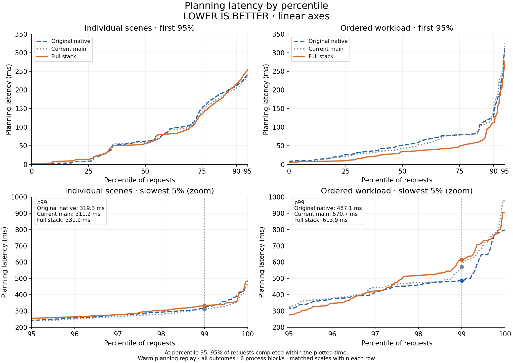
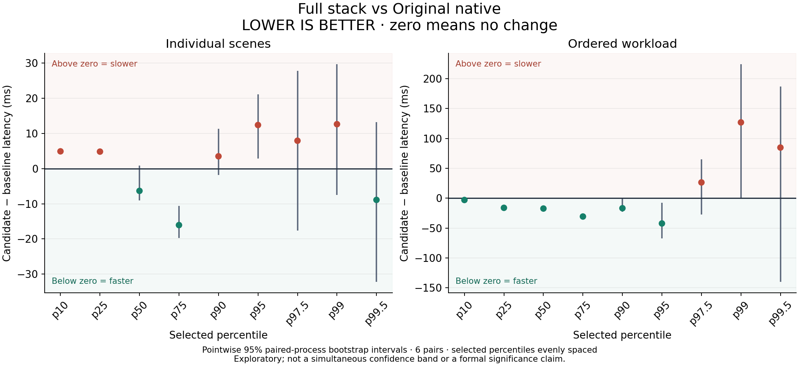
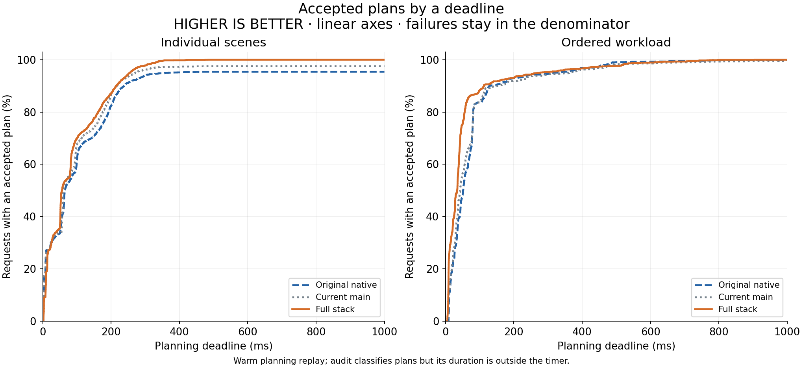

The extracted four-PR stack used **21.7% less ordered planning time than frozen original native**, saving **16.89 ms/request** (exploratory 95% interval: 18.7–24.4% less time). Individual scenes used **2.2% less time**, with an interval crossing no change. **Ordered p99 worsened 26.0%: 487.1 → 613.9 ms.** All 6,024 full-stack attempts, including warmup and the duplicate scene, passed the frozen independent audit.

The four dependent branches are extracted and validated against current main `8ab5892be`. [The four draft PRs and exact head/base identities](PULL_REQUESTS.md) are published in `qwertey6/rdk`; the active account has read-only upstream access. Review order is **main ← PR1 ← PR2 ← PR3 ← PR4**. Each branch contains runtime changes and its own regression tests/fixtures. Reports, figures, runners and manifests are auxiliary evidence; none appears in the production diffs.

| PR | Branch | Runtime | Tests / fixtures | Files |
|---|---|---:|---:|---:|
| 1 | `jake/native-1-correctness` | +192/−71 | +474/−4 | 21 |
| 2 | `jake/native-2-kinematics` | +376/−14 | +634/−0 | 13 |
| 3 | `jake/native-3-collision` | +1,050/−87 | +1,101/−1 | 25 |
| 4 | `jake/native-4-finishing` | +540/−48 | +978/−0 | 19 |

The combined diff against main is **+2,156/−218 runtime lines** (33 files) and **+3,187/−5 test/fixture lines** (38 files). Per-PR totals differ slightly because two lines change again higher in the stack.

The initial extraction exposed an unsafe intermediate: adding faster FK before the stricter collision checker increased invalid returned paths. Required collision fidelity, exact scene identity and the removal of unsafe clearance skipping now land in PR1. A saved failed trajectory is a regression test. PR3 then accelerates those checks conservatively. This repartition does not change cumulative PR3 or full-stack runtime code; source equivalence is recorded below.

| PR versus preceding head | Individual scenes: total-time change | Ordered: total-time change | Independent blocks |
|---|---|---|---:|
| 1 | +144.4% (+123.82 ms/request; exploratory 95% interval +141.7% to +148.6%) | +47.9% (+36.90 ms/request; exploratory 95% interval +44.8% to +50.9%) | 3 |
| 2 | -9.8% (-20.59 ms/request; exploratory 95% interval -11.6% to -6.6%) | -7.5% (-8.53 ms/request; exploratory 95% interval -12.1% to -4.3%) | 3 |
| 3 | -46.9% (-88.69 ms/request; exploratory 95% interval -48.1% to -46.0%) | -37.3% (-39.34 ms/request; exploratory 95% interval -38.7% to -35.4%) | 3 |
| 4 | -14.7% (-15.01 ms/request; exploratory 95% interval -17.4% to -11.1%) | -10.8% (-7.36 ms/request; exploratory 95% interval -13.7% to -7.9%) | 6 |

Signed changes above: **negative means less planning time**. PRs 1–3 use a separate three-block follow-up; PR4 uses the six-block full-stack cohort. Each effect compares complete planning calls with the preceding cumulative head. These percentages must not be added or pooled across cohorts. PR1 is correctness/lifetime work and increases latency substantially here. Review the four changes separately, but coordinate their rollout: PR1/2 are slower intermediate states, and the later PRs recover that cost.

The four review descriptions include their mechanisms, original-native comparisons and their own charts:

- [PR1: collision validity and worker lifetime](01-correctness-and-worker-lifetime.md)
- [PR2: native FK and IK](02-native-fk-and-ik.md)
- [PR3: collision checking and scene reuse](03-collision-and-scene-reuse.md)
- [PR4: optional finishing and smoothing](04-finishing-and-smoothing.md)

| Workload / variant | Accepted / attempts | Total s | Median ms | p95 ms | p99 ms |
|---|---:|---:|---:|---:|---:|
| Individual scenes: Original native | 3,148 / 3,300 | 293.580 | 62.33 | 242.10 | 319.28 |
| Individual scenes: Current main | 3,217 / 3,300 | 284.013 | 59.48 | 238.46 | 311.17 |
| Individual scenes: Full stack | 3,300 / 3,300 | 287.114 | 55.99 | 254.46 | 331.88 |
| Ordered workload: Original native | 1,762 / 1,764 | 137.054 | 51.63 | 317.46 | 487.06 |
| Ordered workload: Current main | 1,755 / 1,764 | 134.634 | 42.77 | 325.17 | 570.66 |
| Ordered workload: Full stack | 1,764 / 1,764 | 107.259 | 34.31 | 275.17 | 613.91 |

Percentile is horizontal and milliseconds vertical, with linear axes and a separate tail zoom. Completion curves include failed attempts. Original native remains first; current main is an additional comparator.

The ordered p99 difference is **+126.84 ms**, with an exploratory pointwise 95% interval **+0.33 to +224.33 ms**. Adjacent extreme-tail intervals cross zero. Six independent processes and many endpoints do not support a formal significance or precise-p99 claim. The median/mean improvement does not establish a uniform distribution improvement. The declared tail gate is not met, so this is a reviewable performance/correctness stack, not a deployment certification.

Path-quality flags versus original: **scenes/scene04.json: path-length p95 11.7% longer**. These are accepted-plan joint-space lengths; they do not establish robot execution duration. PR3 also introduces a **512 MiB / 128-entry** scene-cache budget. Missing per-request cache diagnostics in shipping heads are unavailable, not zero. Whole-process peak RSS was 10.60–11.01 GiB for original and 10.43–11.19 GiB for the full stack. This includes warmup/auditing and must not be called retained cache memory or robot execution footprint.

The metric is warm planning replay through the actual motion-service `PlanMotion` call: IK, search, required validation, smoothing, final path construction and synchronous cleanup. Snapshot preparation, RPC, declared warmup, independent audit and hardware execution are excluded. This measures end-to-end planning within that boundary, not request-to-first-motion or physical completion.

Original native is always the primary baseline. All variants use ordinary native routing, default workers and automatic production calibration. Effective calibration varies across heads/processes, so these measurements include the production policy response; they do not isolate constant-budget implementation cost. Runs were serial under recorded desktop activity; no load-based exclusion or retry. Individual-scene headlines weight 11 unique requests equally; duplicate scene08 stays in the ledger with zero headline weight. Ordered results preserve a whole 98-request warmup followed by three dependent passes per process. Paired bootstrap intervals resample whole independent process blocks. All outcomes count; accepted-only distributions, per-process/per-input results, maxima, threshold counts, trajectories and audit accounting are retained. Dense audit is evidence at its resolution, not proof of continuous collision freedom.

One earlier follow-up attempt stopped after the sandbox denied the timing wrapper’s resource query. Its 704 requests all finished; that incomplete cohort is retained and audited separately in [execution-restart.json](evidence/execution-restart.json). The complete follow-up was restarted with the required access, independent of latency. The server restart later left the benchmark running; no measurements were repeated for it.

The whole-stack cohort has six independent blocks, 36 serial processes, 32,184 measured attempts and 36,144 total attempts across six initial variants. The corrected-boundary follow-up has three blocks, 15 serial processes, 8,910 measured attempts and 10,560 total attempts. All journals and frozen offline audits are reconciled. Initial PR1/2 results remain explicitly labeled superseded, unsafe intermediate boundaries. Their apparent speed is not credited to the current heads.

The six relevant package suites pass on each cumulative head using Go 1.26.10, and configured lint passes against each head’s parent. Focused race checks cover the stack’s concurrent changes, including the corrected validation and cancellation paths. The first two heads’ moved interpolation expectations were checked again after correcting their placement. The observed Go 1.27 JSON round-trip failure also occurs on unchanged main; the complete test passes on the repository toolchain. Full validation and source-equivalence details are in [VALIDATION.md](evidence/VALIDATION.md).

[Full-stack evidence](evidence/full-stack/README.md), [corrected-boundary evidence](evidence/corrected-boundaries/README.md), [source/line-count manifest](evidence/diff-stats.json), and [publication instructions](PREPARATION.md) accompany the descriptions. The [earlier 23.1% cohort](HISTORICAL.md) and [earlier unfavorable cohort](HISTORICAL.md) remain separate; neither is pooled or substituted for this extraction’s result. No 30-second stall was reproduced. Raw archives and binaries remain local and checksum-indexed; committing reports does not back up those payloads.

This branch hosts review material only. It must not be merged into the production stack. The four PRs contain no reports or figures. Raw binaries, trajectories and full local logs remain local; this export is not their backup.
