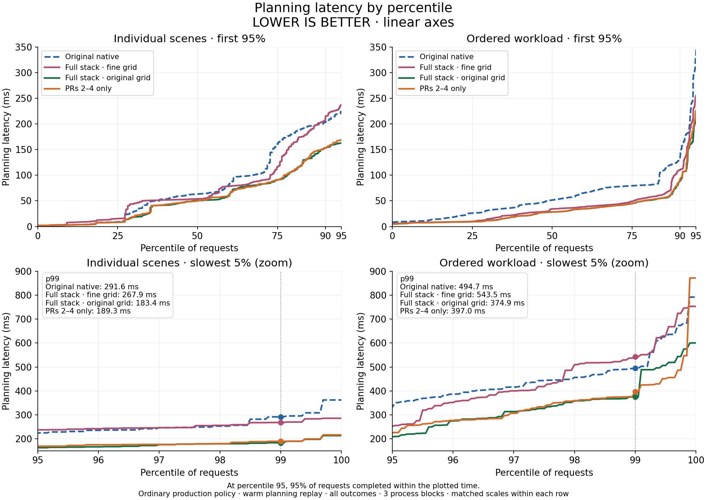
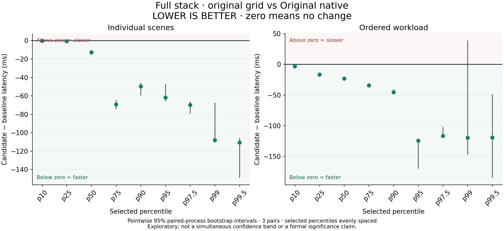
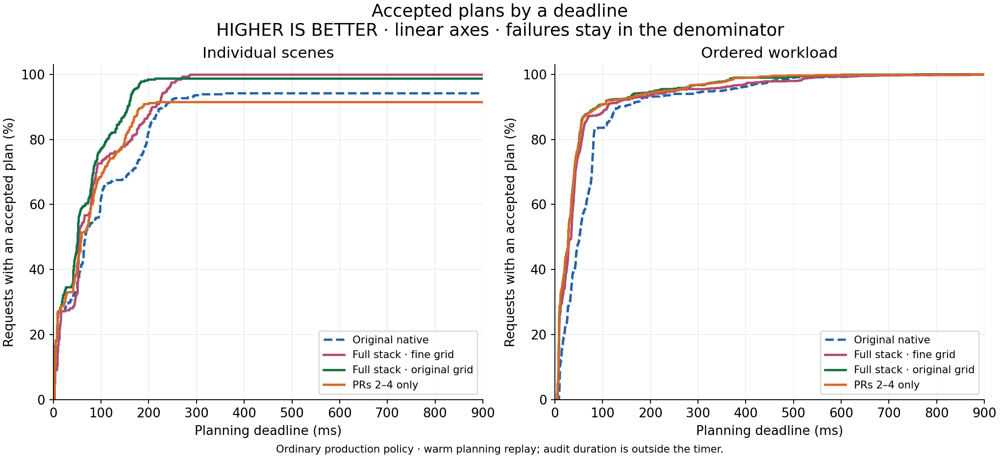

# Native planning with the original sampling policy

Removing all of PR1 while retaining PRs 2–4 reduced ordered-workload whole planning replay time by 37.46% versus original native (77.95 → 48.75 ms/request, 1.60× speedup). Removing only the finer sampling rule performed slightly better: 38.24% less time (48.14 ms/request, 1.62×), while retaining the other fixes. The full finer-grid stack reduced time by 25.07% in this same cohort. Individual-scene time fell by 29.43% with sampling-only removal, versus 4.94% for the finer-grid stack.

Thus the finer rule materially reduces the visible performance gain: removing it saved another 17.57% of ordered planning time and 25.77% of individual-scene time relative to the full stack. This supports separating sampling-policy decisions from the implementation optimizations. It does not prove that the coarser fidelity is acceptable for the intended robot accuracy contract.

All-attempt strict-audit rejections were 27 for original native, 0 for the finer-grid stack, 10 for sampling-only removal, and 36 for literal PR1 removal, each out of 1,572 attempts including warmup. Retaining the other PR1 fixes gave slightly better observed latency and fewer rejected plans than removing the entire PR. This is an observed corpus tradeoff, not proof that any grid guarantees continuous collision freedom.

All twelve declared timing processes and all 6,288 request audits completed; no interrupted request or additional offline rejection was found. Published drafts are unchanged.

## Repeated individual scenes

| Variant | Accepted / attempts | Total planning s | Mean ms | Median ms | p95 ms | p99 ms | Max ms | ≥1s / ≥5s / ≥30s |
|---|---:|---:|---:|---:|---:|---:|---:|---|
| Original native | 311 / 330 | 28.793 | 87.25 | 63.32 | 224.49 | 291.59 | 362.14 | 0 / 0 / 0 |
| Full stack, finer grid | 330 / 330 | 27.371 | 82.94 | 53.85 | 237.20 | 267.87 | 285.63 | 0 / 0 / 0 |
| Full stack, original grid | 326 / 330 | 20.318 | 61.57 | 50.56 | 162.57 | 183.38 | 213.13 | 0 / 0 / 0 |
| PRs 2–4 only | 302 / 330 | 20.614 | 62.47 | 49.82 | 168.81 | 189.28 | 216.24 | 0 / 0 / 0 |

All-outcome latency includes rejected plans. Conditional accepted-plan distributions are separate in the detailed report. A rejected plan is not counted as delivered successfully. Median uses the middle value(s); p95/p99 are nearest-rank pooled raw observations.

| Comparison | Total-time change | Exploratory 95% interval | Mean difference ms/request | Speedup |
|---|---:|---:|---:|---:|
| Full stack, finer grid versus Original native | -4.94% | [-8.31%, -1.58%] | -4.31 | 1.05× |
| Full stack, original grid versus Original native | -29.43% | [-30.77%, -26.71%] | -25.68 | 1.42× |
| PRs 2–4 only versus Original native | -28.40% | [-30.58%, -25.35%] | -24.78 | 1.40× |
| Full stack, original grid versus Full stack, finer grid | -25.77% | [-27.25%, -24.50%] | -21.37 | 1.35× |
| PRs 2–4 only versus Full stack, finer grid | -24.69% | [-27.08%, -22.79%] | -20.48 | 1.33× |
| PRs 2–4 only versus Full stack, original grid | +1.46% | [+0.24%, +2.25%] | +0.90 | 0.99× |

Individual process totals, seconds (block 1 / 2 / 3):

- Original native: 9.758 / 9.405 / 9.630.
- Full stack, finer grid: 8.947 / 9.256 / 9.168.
- Full stack, original grid: 6.756 / 6.893 / 6.669.
- PRs 2–4 only: 6.908 / 7.021 / 6.685.

Within-input accepted joint-space path-length p95 flags (>10% increase; descriptive, with only nine observations per ordered input):

- Full stack, finer grid versus Original native: 2 flagged inputs. scene09.json: +20.7%; scene04.json: +18.3%
- Full stack, original grid versus Original native: 1 flagged inputs. scene04.json: +10.6%
- PRs 2–4 only versus Original native: 1 flagged inputs. scene04.json: +15.9%
- Full stack, original grid versus Full stack, finer grid: 0 flagged inputs. None.

## Complete ordered workload

| Variant | Accepted / attempts | Total planning s | Mean ms | Median ms | p95 ms | p99 ms | Max ms | ≥1s / ≥5s / ≥30s |
|---|---:|---:|---:|---:|---:|---:|---:|---|
| Original native | 881 / 882 | 68.748 | 77.95 | 51.54 | 333.01 | 494.72 | 792.28 | 0 / 0 / 0 |
| Full stack, finer grid | 882 / 882 | 51.512 | 58.40 | 34.26 | 252.43 | 543.50 | 753.42 | 0 / 0 / 0 |
| Full stack, original grid | 881 / 882 | 42.460 | 48.14 | 28.16 | 208.45 | 374.92 | 600.55 | 0 / 0 / 0 |
| PRs 2–4 only | 881 / 882 | 42.998 | 48.75 | 28.25 | 225.45 | 396.96 | 872.00 | 0 / 0 / 0 |

All-outcome latency includes rejected plans. Conditional accepted-plan distributions are separate in the detailed report. A rejected plan is not counted as delivered successfully. Median uses the middle value(s); p95/p99 are nearest-rank pooled raw observations.

| Comparison | Total-time change | Exploratory 95% interval | Mean difference ms/request | Speedup |
|---|---:|---:|---:|---:|
| Full stack, finer grid versus Original native | -25.07% | [-26.01%, -23.89%] | -19.54 | 1.33× |
| Full stack, original grid versus Original native | -38.24% | [-39.44%, -36.12%] | -29.80 | 1.62× |
| PRs 2–4 only versus Original native | -37.46% | [-39.24%, -35.74%] | -29.20 | 1.60× |
| Full stack, original grid versus Full stack, finer grid | -17.57% | [-18.45%, -16.07%] | -10.26 | 1.21× |
| PRs 2–4 only versus Full stack, finer grid | -16.53% | [-17.88%, -15.58%] | -9.65 | 1.20× |
| PRs 2–4 only versus Full stack, original grid | +1.27% | [+0.35%, +2.88%] | +0.61 | 0.99× |

Individual process totals, seconds (block 1 / 2 / 3):

- Original native: 23.456 / 22.220 / 23.072.
- Full stack, finer grid: 17.356 / 16.912 / 17.243.
- Full stack, original grid: 14.204 / 14.194 / 14.062.
- PRs 2–4 only: 14.253 / 14.278 / 14.467.

Within-input accepted joint-space path-length p95 flags (>10% increase; descriptive, with only nine observations per ordered input):

- Full stack, finer grid versus Original native: 0 flagged inputs. None.
- Full stack, original grid versus Original native: 0 flagged inputs. None.
- PRs 2–4 only versus Original native: 1 flagged inputs. 049-153550.610-adding_milk-move.json: +15.1%
- Full stack, original grid versus Full stack, finer grid: 2 flagged inputs. 046-153535.297-adding_milk-move.json: +26.0%; 007-153209.673-locking_portafilter-move.json: +13.3%

The sampling-only variant’s ordered p99 was 374.92 ms versus original native’s 494.72 ms (−119.81 ms). Its exploratory pointwise 95% paired-process interval is [−147.66, +38.85] ms, so the observed p99 improvement remains uncertain. Across the selected ordered percentiles p10 through p97.5, the exploratory intervals were below zero; these are not simultaneous confidence bands or formal significance tests.

The coarse sampling-only stack had no >10% ordered path-length-p95 increase versus original native. Relative to the finer-grid full stack, two ordered inputs increased by 13.3% and 26.0%. Individual-scene path p95 increased 10.6% on scene04 versus original native. Path lengths are joint-space metrics, and no physical execution-time improvement is established.

## Correctness and policy tradeoff

| Variant | Accepted / all attempts including warmup | Rejected measured | Rejected warmup |
|---|---:|---:|---:|
| Original native | 1545 / 1572 | 20 | 7 |
| Full stack, finer grid | 1572 / 1572 | 0 | 0 |
| Full stack, original grid | 1562 / 1572 | 5 | 5 |
| PRs 2–4 only | 1536 / 1572 | 29 | 7 |

Strict auditing remains identical for every variant and is outside the timer. It uses a separate dense grid and original geometry arithmetic in the offline check. This is evidence at that grid’s resolution, not continuous collision proof or an agreed physical-error budget. A legacy sampling rule is not a proven bound on geometric penetration. These data do not establish that the global finer grid is necessary for the intended production accuracy contract.

The sampling-only variant retains the edge-cache, mesh preparation, geometry identity and cancellation fixes. It fails two known geometry regressions after the finer rule is removed: the saved obstacle-crossing path and a two-arm crossing. The other affected package checks passed. Literal PR1 removal additionally reproduces endpoint-cache, NLopt cancellation, exact-shape identity, stale mesh preparation and oversized-worker-lifetime failures. These are separate from the chosen sampling fidelity. Initial PR2/3 test dependency failures and the test-only repairs are retained in the local extraction notes.

## Measurement and uncertainty

The timer surrounds the complete warm PlanMotion call through the motion-service replay: IK, search, required validation, finishing, path construction and synchronous cancellation cleanup. It excludes snapshot preparation, RPC, physical execution, warmup and independent audit. Original native and PRs 2–4 alone may return before all losing workers exit; that asynchronous shutdown time is unavailable. This is whole planning replay latency, not request-to-physical-motion onset.

Three fresh processes per variant; 330 unique-scene measured requests and 882 ordered measured requests per variant. Eleven unique scenes have equal weight. Duplicate scene08 remains in the ledger with zero headline weight. Each process runs the same scene/seed schedule, then a complete 98-request sequence warmup and three ordered passes. Process caches persist according to the frozen harness. There are three independent cache initializations per variant, not 882 independent experiments.

Intervals exhaust 27 paired process-block resamples, preserving all request dependence and scene weights. They are exploratory, with few independent processes and multiple comparisons; no formal significance, precise-p99 or equivalence claim. This cohort is separate from previous reports and is not pooled with them.

All variants use ordinary automatic calibration and default worker policy. Full-stack calibration was 0.2667; sampling-only was 0.2444; literal PRs 2–4 was 0.2444/0.2667/0.2444. Thus the sampling-only contrast measures the whole ordinary-policy effect of changing that rule, including its effect on calibrated budgets and subsequent route choices. It is not a fixed-budget estimate of cost per check.

Apple M5 Pro, 15 logical CPUs, 48 GiB RAM; macOS 26.6 (25G72). Timing compiler Go 1.27.3, matching frozen original. Package checks used Go 1.26.10 because a Go 1.27 JSON round-trip failure also exists on unchanged main. GOGC=100 for individual scenes and 300 for ordered requests, GOMEMLIMIT off, default worker counts (7 IK / 4 search for new variants).

All power observations were AC; per-process median external CPU load ranged from 1.18 to 2.05 cores, with peak 4.69 cores. Shared-desktop interference was recorded and retained. No operator builds/tests/profiles/heavy analysis overlapped timing. No thermal warning was reported at the recorded boundaries; the host-condition summary above is published; detailed snapshots remain in the local experiment.

Peak whole-process RSS ranged from 10.78 to 13.81 GiB. It includes corpus loading and audit and is not cache occupancy. Warmup planning and audit costs are recorded separately in the detailed accounting; one-time compilation/model preparation are outside steady-state latency and were not separately timed in this comparison. Cache-specific memory and phase/work counters are unavailable in the shipping-source builds, not zero.

## Figures and reproducibility

[Detailed distributions, accepted-only latency, every process and every input](report/confirmation-results.md) · [Full-stack versus sampling-only quantile effects](figures/full-vs-coarse/quantile-effects.png) · [PRs 2–4 versus original quantile effects](figures/original-vs-pr234/quantile-effects.png).

This directory publishes readable results and figures. The complete failure ledger, audit accounting, environment snapshots, frozen protocol, source/binary manifests, raw trajectories, journals, executables, and compressed request archives remain in the local experiment and are checksum-indexed there. Publishing these summaries does not back up those payloads. Published code drafts are unchanged.
